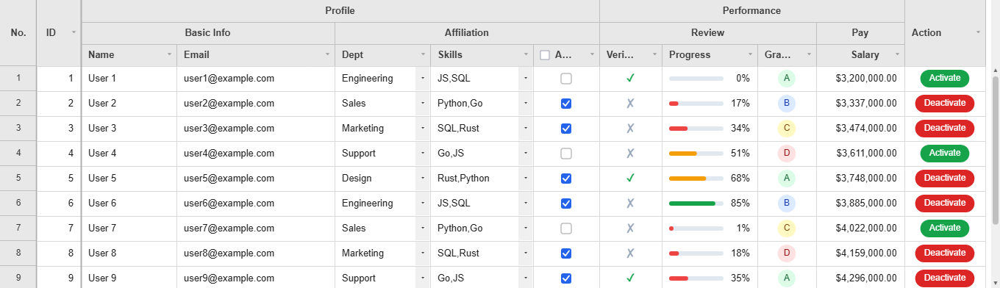

# JHGrid - High-Performance JavaScript Data Grid

The Canvas data grid that gets out of your way.

Zero dependencies. Built-in editing, filtering, undo/redo, and 2D virtualization.

**[▶ Try the live demo](https://jh-grid.github.io/JHGrid/docs/demo)** — Explore large-scale scrolling, editing, filtering, and frozen columns, running directly in your browser.


---

## Features

- **Canvas rendering + 2D virtualization** - smooth at 60/120/144Hz, HiDPI-aware
- **Sizes itself to its container** - fills the element it is given and follows it as the page reflows, or takes a fixed `width`/`height` instead
- **Large-data loading** - chunk-based async loading with prefetch & cache
- **Frozen columns, pinned rows & scrollbars** - left/right column freezing, top/bottom pinned rows (totals), draggable vertical/horizontal scrollbars
- **Pagination** - continuous scrolling or classic pages, with an optional page-size selector
- **Selection & row operations** - cell/range selection, single/multi row selection, row drag reorder (within a grid or between two), hide rows, move a row from code
- **Editing** - inline editing, validation, undo/redo, TSV copy, cut & paste, fill handle, revert one row
- **Rich cell types** - dropdown, multiselect, checkbox, radio, date, richtext, image, button, number, plus custom editors/renderers
- **Filtering & sorting** - set filter, tag filter for huge columns, quick filter, multi-column sort
- **CRUD & change tracking** - row/column add/delete with diff-based persistence
- **Headers & styling** - multi-level headers (lockable against a drag), conditional row/cell styling, wrapped cell text with automatic row height, context menus you can narrow or extend
- **Totals** - a grand total row pinned above or below the data, updated incrementally as cells change
- **Changes at runtime** - subscribe to callbacks with `on()`/`off()`, swap the theme with `setTheme()` or the data source with `setDataSource()`, all without rebuilding the grid
- **State & export** - state snapshot/restore (with or without unsaved edits), CSV export, print preview
- **i18n & accessibility** - KO/JA/ZH localization, screen-reader table navigation over the rows on screen, keyboard navigation with remappable shortcuts, high-contrast support
- **Zero dependencies & theming** - fully themeable with no runtime dependencies

---

## Benchmarks

1,000,000 rows (1M) x 16 columns, every grid on its documented default configuration with no
large-data tuning. Windows 11, i7-12700H, 32GB, headless Chromium. Timed from the API call to each
grid's own "done" signal plus two painted frames. Figures are the median of three runs, except
Grid B, which is a single run: a second load of a million rows takes the renderer past
Chromium's heap cap and it is killed. Run it yourself:
`node scripts/bench-vs-grids.mjs --sizes 1000000 --libs <node_modules with the other grids>`.

Grid A, Grid B and Grid C are three widely used open-source grids, each on its current release and
its own defaults. The figures are one machine's; the script that produced them is in the
repository, so anyone can install those grids and re-run the same measurements.

| 1M rows | **JHGrid** | Grid A | Grid B | Grid C |
|---|---:|---:|---:|---:|
| Create grid, first paint | **67 ms** | 822 ms | 5.94 s | 470 ms |
| Sort text, many repeats | **217 ms** | 1.42 s | 3.17 s | 2.42 s |
| Sort CJK text (locale collation) | **320 ms** | 3.27 s | 9.15 s | 7.88 s |
| Sort text, mostly unique (email) | **967 ms** | 3.87 s | 22.15 s | 5.88 s |
| Sort free text, mixed case | **1.28 s** | 3.50 s | 14.21 s | 5.42 s |
| Sort number, high cardinality | **476 ms** | 2.02 s | 3.73 s | 2.07 s |
| Sort 5 distinct values | **134 ms** | 567 ms | 1.60 s | 1.12 s |
| Filter one value | **33 ms** | 266 ms | 248 ms | 100 ms |
| Filter, then sort inside it | **368 ms** | 1.60 s | 5.54 s | 1.43 s |
| Quick search, every column | **933 ms** | 1.12 s | 1.68 s | 783 ms |
| JS heap after load | **399 MB** | 866 MB | 2,991 MB | 798 MB |
| Scroll 3s, frame p95 / frames over 50ms | **16.7 ms / 0** | 16.7 ms / 0 | 16.8 ms / 0 | 16.7 ms / 4 |

One case goes the other way: sorting text that is *already* in order (a sequential `ORD-...` key)
takes 417ms against Grid A's 150ms. JHGrid's comparator is locale- and numeric-aware, so `item2`
sorts before `item10` and CJK text sorts by its own rules, which costs more per comparison than the
plain string compare those defaults use. The CJK row above is the other side of that trade.

Grid B is headless: it owns the row model and nothing else, so the harness renders its rows
itself (a fixed-height virtualized `<table>`, which is what an app has to build). Its numbers are
that row model plus that renderer, and the 3GB it holds at a million rows is why it only gets one
run here.

Size is what decides whether any of this matters. At 10,000 rows every grid here finishes every
operation in about 33-120ms. At 100,000 the whole set takes **10.3s** against Grid A's 20.2s,
Grid C's 31.8s and Grid B's 33.1s - a gap you can feel but live with. At 1,000,000 it is the
table above.

---

## Installation

### Option A: npm

```bash
npm install @jh-grid/jhgrid-js
```

```js
import { JHGrid } from '@jh-grid/jhgrid-js';
```

The package ships as **ES Modules only** and includes its own TypeScript declarations
(`index.d.ts`), so no `@types/` package is needed. Any bundler (Vite, webpack, Rollup, esbuild) and
modern Node ESM can consume it directly. CommonJS `require('@jh-grid/jhgrid-js')` is *not* supported; use a
dynamic `await import('@jh-grid/jhgrid-js')` if you must load it from a CJS file.

### Option B: ES Module

No build step or package manager: copy `dist/jhgrid.esm.js` to a static resource path of your own
(e.g. a Spring Boot static resource folder) and import it as an ES Module.

```html
<script type="module">
  import { JHGrid } from '/static/jhgrid.esm.js';
</script>
```

### Option C: CDN

A pre-bundled IIFE build is served straight from GitHub via jsDelivr, no npm required.
The global `JHGrid` is the grid constructor, and everything else is exposed on it
(`JHGrid.CellRenderers`, `JHGrid.VERSION`, and so on):

```html
<!-- pin an exact tag for production; @latest resolves to the newest git tag -->
<script src="https://cdn.jsdelivr.net/gh/JH-Grid/JHGrid@latest/dist/jhgrid.min.js"></script>
<script>
  const grid = new JHGrid({
    container: '#my-grid',
    // ...
  });
</script>
```

Before 0.3.4 the global held the exports rather than the constructor, so the grid was built with
`new JHGrid.JHGrid({ ... })`. That form still works.

---

## Quick Start

### Data already in memory (default)

Pass an array you already have (an API response, a small/medium table) straight in via `data`,
no fetch functions needed:

```html
<!-- With no width/height the grid fills this element and follows it as the page reflows,
     so give the container a size. Pass width/height instead for a fixed size. -->
<div id="my-grid" style="width: 100%; height: 700px"></div>

<script type="module">
import { JHGrid } from '@jh-grid/jhgrid-js';

const grid = new JHGrid({
  container: '#my-grid',

  data: [
    { name: 'Alice', age: 30, city: 'Seoul' },
    { name: 'Bob',   age: 25, city: 'Busan' },
  ],

  // Columns allowed to be edited (all columns are readonly if omitted)
  editableCols: '*',   // or ['name', 'age'] for a subset

  // Called whenever a cell value changes. oldValue is the prior edit if the cell was already
  // dirty, otherwise the row's original (pre-edit) value.
  onCellChange: ({ row, field, newValue, oldValue }) => {
    console.log(`[${row}] ${field}: ${oldValue} -> ${newValue}`);
  },
});
</script>
```

See [Local Array Data](docs/data-source.md#local-array-data-data) for how filtering/sorting/`refresh()`
behave against a plain array, and [Responsive Sizing](docs/columns.md#responsive-sizing-responsive) for
sizing to the container versus a fixed `width`/`height`.

### Server-paginated data

For a large dataset that shouldn't be loaded into memory all at once, fetch it page by page
instead:

```html
<div id="my-grid" style="width: 100%; height: 700px"></div>

<script type="module">
import { JHGrid } from '@jh-grid/jhgrid-js';

const grid = new JHGrid({
  container: '#my-grid',
  editableCols: '*',

  fetchMeta: async () => {
    const res = await fetch('/api/grid/meta');
    return res.json(); // { totalRows: number, columns: string[] }
  },

  fetchData: async (page, size) => {
    const res = await fetch(`/api/grid/data?page=${page}&size=${size}`);
    return res.json(); // { rows: object[] }
  },
});
</script>
```

See [`fetchPage`](docs/data-source.md#fetchpage-single-callback-alternative) for a single-callback
alternative to `fetchMeta`+`fetchData` when your backend already returns both together.

A local copy of four of the grids on [`docs/demo.md`](docs/demo.md) — 1,000,000 rows, editing,
filtering, and frozen columns — runs from this repo without hitting the CDN:

```bash
node demo/server.mjs
# open http://localhost:8123/
```

---

## Documentation

**[Browse the docs online](https://jh-grid.github.io/JHGrid/)**, or read them directly in
[`docs/`](docs/README.md), since this README stays a quick landing page:

- **[Getting Started](docs/getting-started.md)**: what a grid needs, the decisions to make up front, using it inside a component, and a troubleshooting table
- **[Features](docs/features.md)**: every feature and the guide that covers it, in one table
- **Guides**: [Data Source](docs/data-source.md), [Columns](docs/columns.md), [Rows](docs/rows.md), [Selection](docs/selection.md), [Editing](docs/editing.md), [Cell Types](docs/cell-types.md), [Renderers & Custom Editors](docs/renderers-editors.md), [Filtering & Sorting](docs/filtering-sorting.md), [Pagination](docs/pagination.md), [Context Menus](docs/context-menus.md), [State & Saving](docs/state-and-saving.md), [Export & Print](docs/export.md), [Localization](docs/i18n.md)
- **Reference**: [Options](docs/reference-options.md) (type and default for every option), [Methods](docs/reference-methods.md), [Callbacks](docs/reference-callbacks.md)
- **[Themes](docs/theming.md)**: the full theme object, styling with your own CSS via `--jhg-*` custom properties, conditional styling, and canvas motion tuning
- **[Interaction Reference](docs/interaction.md)**: every mouse and keyboard interaction, including copy, paste, the fill handle and accessibility
- **[Spring Boot Integration](docs/integration.md)**: backend API shape, SQL paging, sorting and filtering, saving edits
- **[Architecture](docs/architecture.md)**: internal structure and the virtual rendering flow
- **[Performance](docs/performance.md)**: a million rows measured against other grids, and the options that decide the cost
- **[Browser Support](docs/browser-support.md)**: minimum supported versions
- **[Changelog](docs/changelog.md)**: the newest release in full, and a page per earlier version

---

## Browser Support

Chrome/Edge 99+, Firefox 112+, Safari 15.4+: no IE, no legacy Edge, no transpilation or polyfills.
See [docs/browser-support.md](docs/browser-support.md) for details.

---

## License

Proprietary: free to use in your own applications, no redistribution or reverse engineering of
the compiled bundle. See [LICENSE](LICENSE) and [NOTICE](NOTICE).
