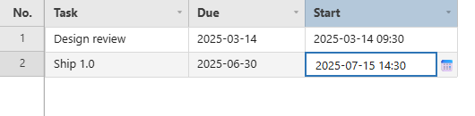
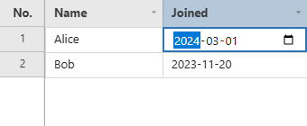
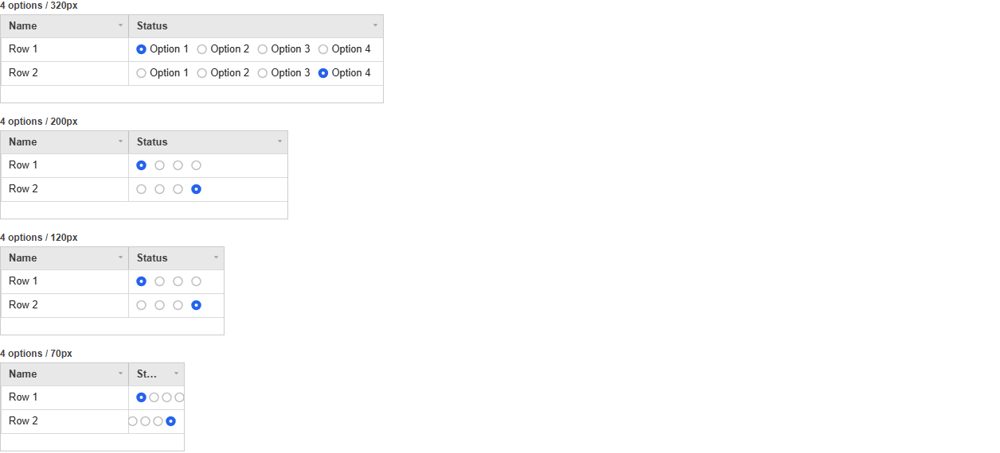
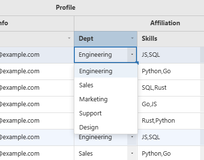
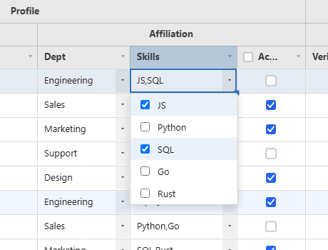
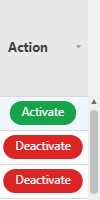
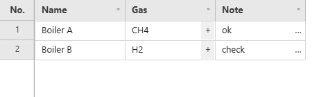

# Cell Types

A column declares its `type`, and the grid supplies the editor, the renderer and the keyboard behaviour that go with it.

**[See it running](demo.md#column-types--renderers)**


## Checkbox Columns (`type: 'checkbox'`)

```js
const grid = new JHGrid({
  container: '#grid',
  data: [
    { name: 'Ada',   active: true  },
    { name: 'Grace', active: false },
  ],
  editableCols: ['active'],
  columnDefs: [
    { field: 'name',   label: 'Name' },
    { field: 'active', label: 'Active', type: 'checkbox', width: 90 },
  ],
  onCellChange: ({ row, field, newValue }) => save(row, field, newValue === 'true'),
});
```

The cell is drawn as a box and counts as checked for `true`, `1`, `'true'`, `'1'`, `'Y'` and `'yes'`.
Clicking it, or pressing `Space` / `Enter` / `F2` on the selected cell, toggles it at once with no
editor. Like any edit this needs the column to be editable, through `editableCols` or
`editable: true`, and what it writes is the text `'true'` or `'false'`, which is what
`getEdits()`, `onCellChange` and `getRowData()` report (convert it with `=== 'true'`). For a select-all
box in the header see [`headerCheckbox`](selection.md#row-selection-rowselection--header-checkbox).

## Date Columns (`type: 'date'`)

A date cell holds **text**, not a `Date` object. Every date column has a pattern: the `format` you
give it, or the one its locale uses when you give none (`'MM/DD/YYYY'` under `en`, `'YYYY-MM-DD'`
under `ko`, `'YYYY/MM/DD'` under `ja` and `zh`). `format: 'locale'` is the one case without a pattern:

| | With a pattern (`format`, or the locale's) | `format: 'locale'` |
|---|---|---|
| Cell shows | the value written in that pattern | the date the way `Intl` writes it for the grid's `locale` (`2024. 3. 1.` under `ko-KR`) |
| Editor | a text box that inserts the separators as you type digits, with a calendar button that opens the native picker | the browser's native date input |
| Saved as | text in that pattern, for example `'25/01/02'` | `YYYY-MM-DD` (`YYYY-MM-DDTHH:mm` with `editorOptions: { mode: 'datetime-local' }`) |
| Valid when | it matches the pattern, or is ISO text, and is a real date: month 1 to 12, a day that exists in that month (leap years included), hour and minute in range | it is ISO text |

`format` is a pattern of `YYYY`, `YY`, `MM`, `DD`, `HH`, `mm` and `ss`; every other character is copied as
it is. A pattern with a time part (`HH`, `mm`) gives the calendar button a date-and-time picker.

```js
const grid = new JHGrid({
  container: '#grid',
  editableCols: '*',
  data: [
    { task: 'Design review', due: '2025-03-14', start: '2025-03-14 09:30' },
    { task: 'Ship 1.0',      due: '2025-06-30', start: '' },
  ],
  columnDefs: [
    { field: 'task',  label: 'Task', width: 160 },
    // No format: the locale's pattern (MM/DD/YYYY under en). min/max limit what the picker offers.
    { field: 'due',   label: 'Due',  type: 'date', width: 130,
      editorOptions: { min: '2025-01-01', max: '2025-12-31' } },
    // With a format: type 2025-03-14 0930 and it becomes 2025-03-14 09:30.
    { field: 'start', label: 'Start', type: 'date', format: 'YYYY-MM-DD HH:mm', width: 170 },
  ],
});
```



Things worth knowing:

- **A value is read through the column's pattern, or as ISO text - never guessed at.** `'2024-03-01'`
  shows as `'24/03/01'` under `YY/MM/DD`, and `'14/03/2024'` shows as `'2024-03-14'` under
  `DD/MM/YYYY`. A value that is neither - `'03/01/2020'` in a `YYYY-MM-DD` column, where there is no
  telling the month from the day - is left exactly as it was loaded: shown, copied and exported as
  that same text, and marked invalid, rather than silently turned into another date. An ISO
  timestamp that names its zone (`'2024-03-01T10:00:00Z'`) is read as an instant and shown in local
  time.
- **An ISO value is at home in any date column.** It is read and displayed in the column's pattern, the
  editor opens on it in that pattern, and it passes validation - so a server that sends ISO needs no
  translation layer. Opening such a cell and closing it without a change leaves the stored ISO text as
  it is; a date the user really types is saved in the column's pattern, so a column fed both formats
  ends up holding both (which displays, sorts, copies and exports the same either way).
- **`format: 'locale'`** shows the date the way the grid's `locale` does (`2024. 3. 1.` for `ko-KR`).
  That is not a pattern an input mask can be built from, so such a column edits with the native date
  picker and stores ISO text (`2024-03-01`); use a pattern when you want the typed, masked input.
- **`editorOptions.min` and `max`** are passed to the native input or calendar as its `min`/`max`. They
  limit the picker, not what can be typed; use `validation` to reject a typed value.
- **`validation.min` and `max`** read the value through the column's `format`, so they work for
  `YY/MM/DD` or `DD.MM.YYYY` as well as ISO text. A limit can be written in the same format or as
  `YYYY-MM-DD` (optionally followed by `HH:mm`). See [Validation](editing.md#validation-columndefsvalidation).
- The date is copied, exported to CSV and printed as displayed, in `format`.



## Radio Columns (`type: 'radio'`)

The same `options` list as a dropdown, drawn in the cell instead of behind a popup: one click
picks, no editor opens. The cell holds the chosen option's `value`, so the column is a text column
to filters, `getEdits()` and a CSV export.

```js
const grid = new JHGrid({
  container: '#grid',
  editableCols: '*',
  data: [
    { name: 'Ada',   stage: 'done' },
    { name: 'Grace', stage: 'todo' },
  ],
  columnDefs: [
    { field: 'name' },
    { field: 'stage', type: 'radio', width: 240,
      options: [{ value: 'todo', label: 'To do' }, { value: 'doing', label: 'Doing' }, { value: 'done', label: 'Done' }] },
  ],
});
```



**It always fits the column.** Labels are drawn while they fit; when they do not, the circles alone
are drawn; when even those do not fit, the gaps tighten and the row slides so the **chosen** option
stays in view. Nothing is ever drawn outside the cell, whatever the width.

| | |
|---|---|
| Cell value | the chosen option's `value` - exactly what a CSV export carries |
| Click | the circle (or its label) under the pointer; a click between them only moves the selection |
| Keyboard | `Space` moves to the next option and wraps. The arrows keep moving between cells |
| Read-only column | drawn the same, nothing changes on click |
| Per-row options | `options` may be a function of the row, like a dropdown's |
| Editor | none - there is nothing to open |

## Dropdown and Multiselect Columns (`type: 'dropdown'` / `'multiselect'`)

`options` lists the choices: strings, or `{ value, label }` objects. A cell **stores and shows the
`value`**; `label` is only the text of the entry in the open list. If people should see "Active"
rather than `'A'`, use the readable text as the value, or draw the label yourself with a custom
renderer.

```js
const grid = new JHGrid({
  container: '#grid',
  editableCols: '*',
  data: [
    { name: 'Ada',   country: 'KR', city: 'Seoul', tags: 'admin,beta' },
    { name: 'Grace', country: 'JP', city: '',      tags: '' },
  ],
  columnDefs: [
    { field: 'name' },
    { field: 'country', type: 'dropdown', options: ['KR', 'JP'] },
    // Options can depend on the row: rowData carries the row as it is now, edits included.
    { field: 'city', type: 'dropdown',
      options: (row) => ({ KR: ['Seoul', 'Busan'], JP: ['Tokyo', 'Osaka'] })[row.country] ?? [] },
    // A multiselect holds its checked values joined by a comma: 'admin,beta'.
    { field: 'tags', type: 'multiselect', width: 180,
      options: [{ value: 'admin', label: 'Administrator' }, 'beta', 'staff'] },
  ],
});
```




- **Opening.** Double-click, or press `Enter` or `F2` on the selected cell, or simply click a cell
  that is already selected. A column with an empty `options` list does not open an editor.
- **Dropdown.** `↑` / `↓` move the highlight, `Enter` or a click picks the entry, and `Escape` or a
  click outside closes the list without changing the cell.
- **Multiselect.** A click ticks or unticks an entry and keeps the list open. `Enter`, `Tab` or a click
  outside commits the ticked values; `Escape` discards them. The joiner is `editorOptions.delimiter`
  (default `','`); set it if a value can contain a comma.
- **Checked automatically.** A dropdown value that is not one of the options, or a multiselect value
  with a part that is not, is marked invalid without any `validation` block, so a typed or pasted
  stray value shows up. An empty value is accepted; add `validation: { required: true }` to reject it.

## Button Columns (`type: 'button'`)



Renders the entire cell as a single clickable button. Activated by mouse click, touch tap, or
Space/Enter/F2 after selecting the cell, and always works regardless of `editableCols` (since it's
an action trigger, not a data edit). Shows a pointer cursor on hover, and clicking it does not draw
a cell-selection border (since it's an action target, not a selected data cell). `label`/`disabled`/
`variant` all support either a fixed value or a `(rowData, rowIndex) => value` function; if the
`label` function returns `null`/`''`, no button is drawn for that row.

Use `setCellValue()` alongside an action that actually changes another column's value (e.g.
toggling active/inactive); the example below toggles the `active` checkbox column via a button,
and the button's own label/color update immediately based on that value.

```js
const grid = new JHGrid({
  container: '#grid',
  fetchMeta, fetchData,
  columnDefs: [
    { field: 'active', label: 'Active', type: 'checkbox' },
    {
      field: 'actions', label: 'Actions', width: 90,
      type: 'button',
      button: {
        label:   (row) => row?.active === 'false' ? 'Activate' : 'Deactivate',
        variant: (row) => row?.active === 'false' ? 'success' : 'danger',
        onClick(rowIndex, rowData) {
          const wasActive = rowData?.active !== 'false';
          grid.setCellValue(rowIndex, 'active', wasActive ? 'false' : 'true');
        },
      },
    },
  ],
});
```

## Cell Buttons (`columnDefs[].cellButton`)

A small always-there click hotspot pinned to a cell's right edge, whatever the column's `type` -
unlike `type: 'button'`, which turns the *whole* cell into a button. The rest of the cell keeps
behaving normally: it still renders its value, still selects, still edits.

```js
{
  field: 'gas2', label: 'Gas 2', width: 100,
  cellButton: { icon: '+', onClick: (rowIndex, rowData, field) => openGasPicker(rowIndex) },
}
```



Both columns in the image, `+` with the default shaded band and `…` with `style: 'plain'`:

```js
new JHGrid({
  container: '#grid',
  data: [
    { name: 'Boiler A', gas: 'CH4', note: 'ok' },
    { name: 'Boiler B', gas: 'H2',  note: 'check' },
  ],
  editableCols: '*',
  columnDefs: [
    { field: 'name', label: 'Name' },
    {
      field: 'gas', label: 'Gas', width: 130,
      cellButton: { icon: '+', onClick: (rowIndex, rowData, field) => openGasPicker(rowIndex) },
    },
    {
      field: 'note', label: 'Note', width: 130,
      cellButton: { icon: '…', style: 'plain', onClick: (rowIndex) => openNote(rowIndex) },
    },
  ],
});
```

Giving it an `icon` is what makes the grid draw it — a shaded band with the glyph centred in it, the
same shape `CellRenderers.dropdown()` gives its arrow, so a button column sits with the grid's other
affordances instead of looking like a one-off. The width it draws is the width it hit-tests, so the
visible band and the clickable band cannot drift apart.

| Option | Default | Meaning |
|---|---|---|
| `onClick` | *(required)* | `(rowIndex, rowData, field) => void`. Fires regardless of `editableCols` — it is an action, not an edit, and takes no part in undo/redo |
| `icon` | – | The glyph to draw. Omit it and nothing is drawn while the hotspot stays clickable, for a host that would rather draw its own mark through `cellDecorator` |
| `width` | `20` | Hotspot width in px, measured in from the cell's right edge |
| `style` | – | `'plain'` drops the shaded band and draws the glyph alone |
| `iconSize` / `iconColor` | `13` / header text colour | Glyph font size and fill |

A click inside the hotspot fires `onClick` and does not start an edit on the cell behind it; the
cursor turns to a pointer there and nowhere else in the cell. An exception thrown by `onClick` is
caught and logged rather than left to break the click handler.
