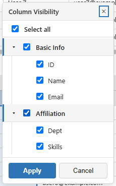
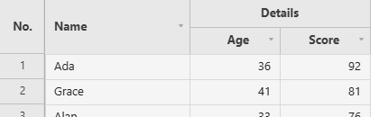
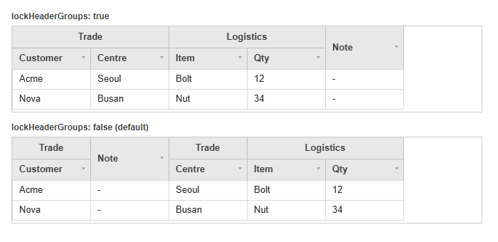
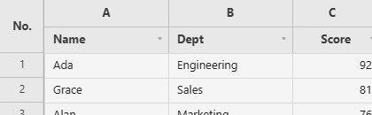
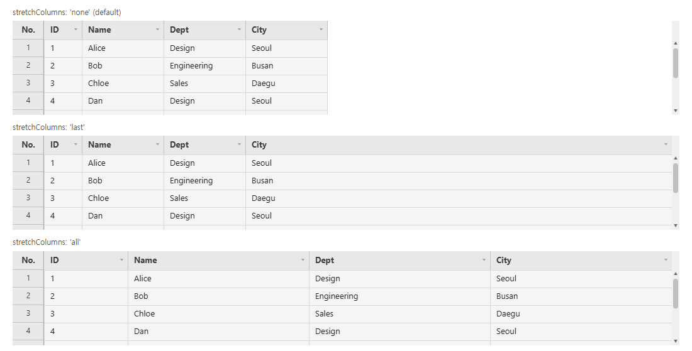
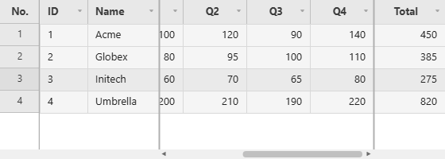

# Columns

The columns themselves: how many there are, how wide they get, and which ones stay put while the grid scrolls sideways.

**[See it running](demo.md#frozen-columns)**

Methods documented here: `addColumn()`, `commitColumns()`, `deleteColumn()`, `getDeletedColumns()`, `getHiddenColumns()`, `getNewColumns()`, `hideColumn()`, `isColumnVisible()`, `showColumn()`, `undeleteColumn()`.


## Adding/Deleting/Hiding Columns (`addColumn` / `deleteColumn` / `hideColumn`)

```js
grid.addColumn('email', { label: 'Email' });                    // appended at the end
grid.addColumn('phone', { label: 'Phone' }, { index: 1 });      // inserted as the second column
grid.deleteColumn('email');
grid.undeleteColumn('email');
grid.getNewColumns();
grid.getDeletedColumns();
grid.commitColumns(['email']); // finalizes the add/delete marks (no longer undoable)

grid.hideColumn('age');
grid.showColumn('age');
grid.isColumnVisible('age');   // boolean
grid.getHiddenColumns();       // string[]
```

- Call these once the grid has loaded its columns: `await grid.ready()` first when it is straight
  after `new JHGrid()`. To start with columns hidden, use the `hiddenColumns` option instead.
- `addColumn(field, def, { index })` takes the same keys as a `columnDefs` entry and returns `false`,
  changing nothing, when a column called `field` exists already (visible, hidden or deleted).
  `deleteColumn(field)` returns `false` for an unknown field. A local column has no data behind
  it: its cells start empty and hold whatever the user enters, which `getEdits()` reports.
- `deleteColumn()` on a column the server sent hides it and records the deletion (`getDeletedColumns()`),
  `undeleteColumn()` brings it back, and `commitColumns()` says the change has been saved. Nothing is
  removed from your data.
- Hidden columns are left out of CSV export and printing, and a double line at the header edge marks
  where one is hidden (`theme.hiddenColIndicator`). The column menu's **Column visibility…** opens a
  dialog with a checkbox per column (below). `onColumnVisibilityChange(hiddenColumns)` reports every
  change.

  
- A column dragged to a new place keeps it through sorts, filters and `reloadData()`.

## Multi-Level Header Groups (`columnDefs[].group`)



Consecutive columns sharing the same label at a given level are automatically merged into a
single header group cell.

```js
columnDefs: [
  { field: 'q1_score', label: 'Q1', group: 'Quantitative' },
  { field: 'q2_score', label: 'Q2', group: 'Quantitative' },
  { field: 'review',   label: 'Comments', group: 'Qualitative' },
],
```
For finer control, define header rows explicitly with the `headerRows` option instead of
`columnDefs[].group`. `headerRows` is `HeaderRowDef[][]`: an array of header rows, each an array
of group cells for that row:

```js
headerRows: [
  [ // top row
    { label: 'Quantitative', fields: ['q1_score', 'q2_score'] },
    { label: 'Qualitative',  fields: ['review'] },
  ],
],
columnDefs: [
  { field: 'q1_score', label: 'Q1' },
  { field: 'q2_score', label: 'Q2' },
  { field: 'review',   label: 'Comments' },
],
```

| `HeaderRowDef` field | Type | Description |
|---|---|---|
| `label` | `string` | The group cell's text |
| `fields` | `string[]` | Field names this group spans. Recomputed automatically after a column reorder, so it always tracks the current column order rather than a fixed position |
| `colspan` | `number` | Explicit column span, if it shouldn't be inferred from `fields.length` |
| `rowspan` | `number` | How many header rows tall the cell is (for a group with no further subdivision below it) |
| `align` | `'left' \| 'center' \| 'right'` | Group cell text alignment |

### Keeping a Group Whole While Dragging (`lockHeaderGroups`)

A group cell is drawn over the columns of that group that happen to sit next to each other, so a
column dragged out of its group, or an outsider dropped into the middle of one, splits that cell in
two. `lockHeaderGroups: true` stops both: the insertion point moves to the nearest edge that leaves
every group in one piece.



```js
new JHGrid({
  container: '#grid',
  lockHeaderGroups: true,
  columnDefs: [
    { field: 'customer', label: 'Customer', group: 'Trade' },
    { field: 'centre',   label: 'Centre',   group: 'Trade' },
    { field: 'qty',      label: 'Qty' },
  ],
  data: rows,
});
```

- A column **in** a group can be reordered within that group, and no further.
- A column **outside** every group can be dropped before or after a group, never inside it.
- It is off by default, where a drag may split a group; turning it on changes only what a drag can
  do, never the columns the grid starts with or `hideColumn()` / `addColumn()`.
- Only the top header row is enforced. A group nested under another moves with its parent run.

## Changing Many Columns at Once (`batchStructural`)

Every `addColumn()` / `deleteColumn()` snapshots the grid structure for undo and repaints. That is right for
one column and wrong for three hundred: the work is quadratic, and deleting 1,000 columns one by
one took 6.5 seconds. `batchStructural(fn)` runs the whole set as one snapshot, one repaint, one
accessibility header rebuild and one undo step.

```js
grid.batchStructural(() => {
  for (const field of toRemove) grid.deleteColumn(field);
  for (const [i, def] of toAdd.entries()) grid.addColumn(def.field, def, { index: i });
});
```

Measured on 1,000 columns: **6451ms one by one, 58.8ms batched**. `Ctrl+Z` puts them all back in
one step. Row changes made inside the callback (`addRow`, `deleteRow`) join the same step.

## Column Letter Header (`columnLetterHeader`)

Adds an Excel-style row of column letters (A, B, C, ...) above the header, handy when users refer
to cells the way a spreadsheet does. The letter cells are labels only: no sort, filter or checkbox.



```js
const grid = new JHGrid({
  container: '#grid',
  columnLetterHeader: true,
  data: [
    { name: 'User 1', dept: 'Engineering', score: 30 },
    { name: 'User 2', dept: 'Sales',       score: 47 },
  ],
});
```

## Responsive Sizing (`responsive`)

`responsive` is **on by default** as long as you don't pass `width`/`height`: the grid fills its
container and follows it as the container resizes, via `ResizeObserver`. Size the container with CSS -
it needs a height of its own, since an element that is only as tall as its content has none to give,
and the grid then falls back to the fixed 1200 x 700 default until the container does have a size.

```html
<div id="grid" style="width: 100%; height: 60vh;"></div>

<script type="module">
import { JHGrid } from '@jh-grid/jhgrid-js';

new JHGrid({
  container: '#grid',
  // responsive: true is the default here - no width/height given
  data: [{ name: 'Alice', age: 30 }, { name: 'Bob', age: 25 }],
});
</script>
```

Pass `width`/`height` (or `responsive: false`) to opt back into a fixed size instead: `width` and
`height` are ignored (with a console warning) whenever `responsive` ends up on. With `pagination` on,
the pager bar is taken out of the container's height, so the rows keep whatever room is left. In a
flex or grid layout give the container `min-height: 0` (and `min-width: 0`) so it can shrink with its
parent. Browsers without `ResizeObserver` size the grid once (or use the fixed default) and do not
follow later changes.

## Filling the Width (`stretchColumns`)

Columns have fixed widths, so a grid with few columns in a wide container leaves the rest of the row
blank. `stretchColumns` hands that space to the columns instead.

```js
new JHGrid({
  container: '#grid',
  stretchColumns: 'last',   // the last scrollable column takes the leftover space
  // stretchColumns: 'all',  // split it between the columns, in proportion to their widths
  // stretchColumns: 'none', // the default: leave it blank
  data: rows,
});
```

It only ever **adds** width. A column never ends up narrower than the width it would have had
anyway - its `columnDefs` `width`, or `colWidth`, or whatever the user dragged it to - so when the
columns already overflow the grid nothing changes and the horizontal scrollbar behaves as before.

Two kinds of column keep their own width and take no share:

- **Frozen columns** (`frozenCols` / `frozenColsRight`). Widening a frozen column eats into the
  scrollable band, which can push the grid into dropping that column out of the frozen band and
  back again as the window resizes.
- **Columns the user has resized by hand**, by dragging the header border or through
  `autoFitColumns(field)`. Otherwise dragging the column that absorbs the slack would do nothing:
  the freed pixels would be handed straight back to it. With `'last'`, the leftover then goes to
  the rightmost column the user has *not* sized; if they have sized every one, the space stays
  blank, which is what they asked for. `refresh()` clears those manual widths and the stretch
  takes over again.

The widths are recomputed when the layout changes - the grid is resized, a column is added, hidden,
shown or deleted, the frozen counts change, a state is restored - and never per frame.

`getState().columnWidths` reports each column's own width, not its stretched one, and
`getState().userSizedColumns` lists the columns the user sized by hand. That is what makes a layout
saved on a 1,600px screen restore correctly inside a 900px one: the stretch is recalculated for the
window it is restored into. See [State Snapshot/Restore](state-and-saving.md#state-snapshotrestore-getstate--setstate).



## Frozen Columns (`frozenCols` / `frozenColsRight`)

Keeps the first *n* columns (`frozenCols`) and/or the last *n* (`frozenColsRight`) in place while the
columns between them scroll sideways. A separator line (`theme.frozenBorder`) marks each edge. The
row-number gutter is always fixed and is not counted.



```js
const grid = new JHGrid({
  container: '#grid',
  data: rows,
  width: 560,
  frozenCols: 2,        // ID and Name stay on the left
  frozenColsRight: 1,   // Total stays on the right
  columnDefs: [
    { field: 'id',    label: 'ID',    width: 60 },
    { field: 'name',  label: 'Name',  width: 90 },
    { field: 'dept',  label: 'Dept',  width: 110 },
    { field: 'q1',    label: 'Q1',    width: 80, align: 'right' },
    // ... more columns ...
    { field: 'total', label: 'Total', width: 90, align: 'right' },
  ],
});
```

Users can also toggle it from the column header's right-click menu: *Freeze columns to the left* freezes that
column and everything to its left, *Freeze columns to the right* freezes that column and everything
to its right (`colContextMenuItems` can hide those entries). The counts are part of
[`getState()`/`setState()`](state-and-saving.md#state-snapshotrestore-getstate--setstate).

If the frozen columns would leave less than one default column width for the scrolling part, the
grid freezes fewer columns instead, so the scrollable area can never be squeezed to nothing.
Frozen columns work together with [pinned rows](rows.md#pinned-rows-pinnedtoprows--pinnedbottomrows--pinrow).
