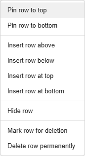
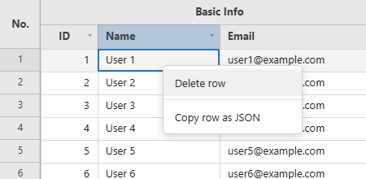

# Context Menus

Three menus (row number, header, cell), each taking the built-in items, a subset of them, or items of your own.

Methods documented here: `setOptions()`.

## Context Menus (`rowContextMenuItems` / `colContextMenuItems` / `cellContextMenuItems` / `setOptions`)

Right-clicking opens one of three menus, depending on where the pointer is. On a touch screen a
half-second press does the same, and on the keyboard `ContextMenu` or `Shift+F10` opens the menu of
a focused column header or row number.

| Right-click on | Items | Narrowed by |
|---|---|---|
| A row number | Pin row to top / to bottom, Unpin row; Insert row above / below / at top / at bottom; Hide row and Show all hidden rows; Mark row for deletion and Delete row permanently (for a row from the server), Delete row (for a row you added), Undo delete | `rowContextMenuItems` |
| A column header | Freeze columns to the left / Unfreeze, Freeze columns to the right / Unfreeze, Column visibility…, Insert column left / right, Delete column / Undo delete | `colContextMenuItems` |
| A cell | Insert column left / right, Delete column, Insert row below, Delete row, followed by your own items | `cellContextMenuItems` and `cellContextMenuExtraItems` |



Each option is `false` to switch that menu off (a right-click then does nothing), or a list of the
keys to keep, or left out to show everything. An unknown key is ignored with a console warning
that lists the valid ones. `'row-delete'` stands for every delete-related item of the row menu and
`'row-pin'` for every pin item, since which of them shows depends on the row. Rows you supplied
through `pinnedTopRows` / `pinnedBottomRows` / `setPinnedRows()` get no row menu.

```js
const grid = new JHGrid({
  container: '#grid',
  data: rows,
  editableCols: '*',
  rowContextMenuItems:  ['row-insert-above', 'row-insert-below', 'row-delete'],  // no pin, no top/bottom insert
  colContextMenuItems:  ['freeze', 'freeze-right', 'visibility'],                // no insert or delete column
  cellContextMenuItems: ['row-delete'],
});
```

**Adding your own cell menu items.** `cellContextMenuExtraItems` is called each time the cell menu
opens and returns `{ label, onClick, disabled? }` items (or `null`) to add after the built-in ones. It
is the way to attach an action to a cell. `onClick` gets the same context, so it can use the row's
data or the pointer position:

```js
new JHGrid({
  container: '#grid',
  data: users,
  cellContextMenuItems: ['row-delete'],
  cellContextMenuExtraItems: ({ row, field, rowData }) => [
    { label: `Copy ${field}`,
      onClick: () => navigator.clipboard.writeText(String(rowData?.[field] ?? '')) },
    { label: 'Open user',
      disabled: !rowData?.id,
      onClick: ({ rowData }) => { location.href = `/users/${rowData.id}`; } },
  ],
});
```



The context is `{ row, col, field, rowData, clientX, clientY }`; `clientX` / `clientY` are viewport
coordinates, so you can anchor your own popup at the cell. `rowData` is `null` for a row that has
not loaded.

**Changing them later.** `setOptions(patch)` changes these options on a live grid. The options it
accepts are the three menu filters, `cellContextMenuExtraItems`, `rowPinButton`,
`onRowPinToggle` and `editableCols`; anything else is read once when the grid is built, so it is
ignored with a console warning (the other keys of the same call still apply) and needs a new grid.
Passing `undefined` for a menu option puts it back to showing everything. Menus that are open close,
and a `patch` that is not an object throws a `TypeError`.

```js
// Switch the editing menus off while a record is locked, and back on afterwards.
function setLocked(locked) {
  grid.setOptions({
    rowContextMenuItems:  locked ? false : undefined,
    cellContextMenuItems: locked ? false : undefined,
    colContextMenuItems:  locked ? ['freeze', 'freeze-right', 'visibility'] : undefined,
  });
}

grid.setOptions({ rowPinButton: 'bottom' });   // pin icons now pin to the bottom band
```

**View mode / edit mode without rebuilding the grid.** `editableCols` takes the same values here as
in the constructor (`string[]` or `'*'`) and is applied immediately - no `destroy()`/recreate, so
scroll position, selection and undo history all survive the switch:

```js
const grid = new JHGrid({ container: '#grid', data: rows, editableCols: [] }); // starts read-only

viewModeToggle.addEventListener('change', (e) => {
  grid.setOptions({ editableCols: e.target.checked ? '*' : [] });
});
```

A `columnDef.editable` override still wins either way - it forces a column editable or read-only
regardless of what `editableCols` says, live or at construction.
