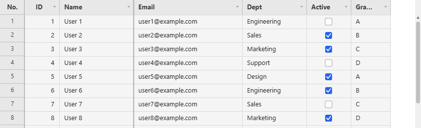
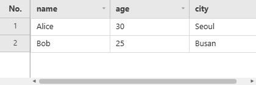

# Data Source

A grid takes its rows from exactly one of these: an async backend pair, a single async callback, or an array you already have in memory.

**[See it running](demo.md#1000000-rows)**


## Data Source Interface

Give the grid `fetchMeta` + `fetchData` for a backend that answers the two questions separately,
`fetchPage` for one that answers both at once, or `data` for an array already in memory. Exactly one
of the three is required, and the first two are called again whenever a filter, a sort or a scroll
needs rows the grid does not have.

## `fetchMeta`

```ts
fetchMeta: (state?: GridFilterState | null) => Promise<{
  totalRows: number;   // total number of rows in the dataset (after state's filters, if any)
  columns: string[];   // ordered list of column keys
}>
```

`state` is the sort/filter/quick-filter the grid wants applied, the same shape `fetchData`
receives (see below). A `fetchMeta` that ignores it still works, it just always reports the
unfiltered total, which makes the scrollbar/row count wrong the moment a filter or sort is active.

## `fetchData`

```ts
fetchData: (page: number, size: number, state?: GridFilterState | null) => Promise<{
  rows: Record<string, unknown>[];  // `size` rows starting at offset page*size, honoring `state`
}>
```

```ts
interface GridFilterState {
  sorts:   { field: string; dir: 'asc' | 'desc' }[];
  // string = substring match (setFilter()); string[] = exact-match checkbox selection (setFilterValues())
  filters: Record<string, string | string[]>;
  quickFilter: string; // '' when inactive
}
```

JHGrid never filters or sorts data itself; it only tracks *what* the user asked for (which
column, which values, which direction) and hands that to `fetchMeta`/`fetchData` as `state` on
every call. Applying it (a `WHERE`/`ORDER BY` on a real backend, or an `Array.filter`/`sort` for
an in-memory source) is entirely the host's responsibility; a callback that ignores `state`
simply never filters or sorts.

Row objects must use the **same keys** as the `columns` array returned by `fetchMeta`.

```json
// fetchMeta → { "columns": ["name", "age", "city"] }
// fetchData → { "rows": [{ "name": "Alice", "age": 30, "city": "Seoul" }] }
```

How `columns` and `columnDefs` combine:

- The order of `columnDefs` wins. Columns the server reports that `columnDefs` does not mention are
  appended after them, as plain text columns.
- A `columnDefs` entry whose `field` the server did not report is ignored.
- Without `columnDefs`, the grid shows exactly the columns `fetchMeta` reports, in that order.

`page` is the 0-based index of a chunk of `size` rows, not a row number: page `2` with `size: 300`
is rows 600 to 899. `size` is the `chunkSize` option (or the page size when `pagination` is on).

```js
const grid = new JHGrid({
  container: '#grid',
  editableCols: '*',
  fetchMeta: async (state) => {
    const res = await fetch('/api/users/meta', {
      method: 'POST',
      headers: { 'Content-Type': 'application/json' },
      body: JSON.stringify(state ?? {}),           // sorts, filters, quickFilter
    });
    return res.json();                             // { totalRows: 1250, columns: ['id', 'name', 'dept'] }
  },
  fetchData: async (page, size, state) => {
    const res = await fetch('/api/users/data', {
      method: 'POST',
      headers: { 'Content-Type': 'application/json' },
      body: JSON.stringify({ page, size, ...(state ?? {}) }),
    });
    return res.json();                             // { rows: [ { id: 1, name: 'Alice', dept: 'Sales' }, ... ] }
  },
});
```

**Errors and retries.** A `fetchData` call that rejects (a network error, an HTTP error you turned
into a throw) is retried twice more, after 0.5 s and then 1 s. When the third attempt fails the grid
shows `i18n.loadError` in a banner for a few seconds, calls `onChunkError(err)`, and leaves that
chunk empty for about 5 seconds before it will ask for it again. A response that is not shaped like
`{ rows: [] }` is reported the same way but not retried, since asking again cannot fix it. Check
`res.ok` yourself, because `fetch` only rejects on network failure:

```js
fetchData: async (page, size, state) => {
  const res = await fetch(`/api/users?page=${page}&size=${size}`);
  if (!res.ok) throw new Error(`HTTP ${res.status}`);   // retried, then onChunkError
  return res.json();
},
onChunkError: (err) => console.error('load failed', err),
```

A chunk that failed is not retried on sight: it stays empty for about five seconds, so a dead
backend is asked once per chunk per five seconds rather than on every frame that scrolls over it.
`reloadData()` and `refresh()` clear that cooldown, as does `setDataSource()`.

The grid keeps at most two chunk requests in flight and holds new requests while the user is
actively wheel-scrolling, so a fast scroll over a huge dataset asks only for the chunks it lands on.

## `fetchPage`: single-callback alternative

For a backend that already returns a page of rows *and* the total count together in one round
trip (e.g. a SQL `COUNT(*) OVER()` alongside the paged query), `fetchPage` collapses
`fetchMeta`+`fetchData` into a single callback instead of two:

```ts
fetchPage: (page: number, size: number, state?: GridFilterState | null) =>
  Promise<{
    rows: Record<string, unknown>[];
    totalRows: number;
    columns?: string[]; // only needed if not already provided via columnDefs
  }>
```

```js
const grid = new JHGrid({
  container: '#grid',
  columnDefs: [{ field: 'id' }, { field: 'name' }, { field: 'dept' }],
  fetchPage: (page, size, state) =>
    fetch('/api/grid', {
      method: 'POST',
      headers: { 'Content-Type': 'application/json' },
      body: JSON.stringify({ page, size, state }),
    }).then(res => res.json()), // { rows, totalRows }
});
```

The grid still asks for chunk 0 once at boot even though it needs both the row count and the rows
from that same call, so a plain `(page, size) => …` implementation isn't invoked twice for the
same page. Only one data source applies: supplying `fetchMeta`/`fetchData` alongside `fetchPage`
leaves those two in charge and `fetchPage` is ignored.



## Local Array Data (`data`)

For a dataset that already fits in memory (prototyping, a small/medium lookup table, tests)
pass a plain array via `data` instead of writing `fetchMeta`/`fetchData` yourself. Columns are
inferred from `columnDefs` if given, else from the keys of `data[0]`.

```js
const grid = new JHGrid({
  container: '#my-grid',
  data: [
    { name: 'Alice', age: 30, city: 'Seoul' },
    { name: 'Bob',   age: 25, city: 'Busan' },
  ],
  editableCols: '*',
});
```



Filtering, sorting, and the quick filter are applied against the array directly (same semantics a
server-backed `fetchMeta`/`fetchData` is expected to implement; see `onFilter`/`onSort`). This
re-scans the whole array on every state change with no indexing, so it's meant for small/medium
datasets; a large dataset still belongs behind `fetchMeta`/`fetchData` against a real, indexed
backend. `refresh()` and `reloadData()` re-read the same array reference, so mutating it
externally and calling one of them picks up the change.

What the grid does with the array:

- **Columns.** With `columnDefs`, only the declared fields become columns; a key of the rows that
  is not declared is not shown. Without it, the columns are the keys of `data[0]`. An empty array
  needs `columnDefs`, otherwise the constructor throws.
- **Edits stay in the grid.** Editing a cell never writes into your array. Read the changes with
  [`getEdits()`](reference-methods.md#getedits) and apply them to your own data.
- **Text filter** (`setFilter`, the filter panel's search box): case-insensitive substring match on
  that field. **Set filter** (`setFilterValues`, the checklist): exact match on the value as text.
- **Quick filter** (`setQuickFilter`): case-insensitive substring match against *every* value of the
  row object, including keys that have no column.
- **Sorting.** Two numbers compare as numbers; a `type: 'date'` column compares as dates read through
  its pattern, so `'12/31/2019'` sorts before `'03/01/2020'` under `MM/DD/YYYY`; anything else compares
  as text with numeric collation, so `'item2'` sorts before `'item10'`. Empty values, and a date value
  the pattern cannot read, compare as text.

```js
const users = [
  { id: 1, name: 'Alice', dept: 'Sales',       salary: 5200 },
  { id: 2, name: 'Bob',   dept: 'Engineering', salary: 6100 },
  { id: 3, name: 'Chloe', dept: 'Sales',       salary: 4800 },
];

const grid = new JHGrid({
  container: '#grid',
  data: users,
  editableCols: ['name', 'salary'],
  columnDefs: [
    { field: 'id',     label: 'ID',     width: 60 },
    { field: 'name',   label: 'Name' },
    { field: 'dept',   label: 'Dept' },
    { field: 'salary', label: 'Salary', align: 'right' },
  ],
});

grid.setSort('salary', 'desc');     // Bob, Alice, Chloe
grid.setQuickFilter('sales');       // Alice, Chloe

// The array itself is untouched by edits. Merge them yourself before saving:
const edits = grid.getEdits();      // { 0: { salary: '5300' } }, row index -> field -> text
```

Ignored if `fetchMeta`/`fetchData` or `fetchPage` is also provided.

---

## Changing the Data Source at Runtime (`setDataSource`)

`setDataSource()` points a running grid at a different source. It takes the same three shapes the
constructor takes, and then starts over exactly as [`refresh()`](reference-methods.md#refresh)
does - unsaved edits, filters, sorts, selection, column widths and order are dropped, because the
new source need not even have the same columns.

```js
grid.setDataSource({ fetchMeta, fetchData });        // another backend
grid.setDataSource({ fetchPage });                   // the single-callback shape
grid.setDataSource({ data: rows });                  // an array already in memory
await grid.ready();                                  // resolves once the first rows are in
```

Use [`reloadData()`](reference-methods.md#reloaddata) instead when the source is the same and only
the data behind it changed: that keeps filters, sort and column state.

Columns declared in `columnDefs` stay declared: a source whose rows have other fields shows those
columns empty. Leave `columnDefs` out to let each source bring its own columns.
