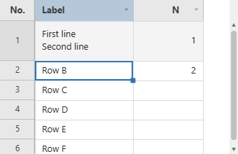

# Editing

Inline editing: how the editor behaves, and what happens to a value that fails validation.

**[See it running](demo.md#editing)**

## Editor Options (`columnDefs[].editorOptions`)

Each built-in editor is a `CellEditors` entry, chosen by the column's `type` or named with
`editor: 'key'`. `editorOptions` are handed to it:

| Editor key | Chosen by | `editorOptions` |
|---|---|---|
| `text` | `type: 'text'` (the default) | none |
| `textMultiline` | automatically for a value that contains a line break, or `editor: 'textMultiline'` | none |
| `date` | `type: 'date'` | `mode`: `'date'` (default) or `'datetime-local'`, used when the column's `format` is `'locale'`. `min` / `max`: limits for the native picker, as `'YYYY-MM-DD'` text. See [Date Columns](cell-types.md#date-columns-type-date) |
| `number` | `editor: 'number'` | `decimals` (default `0`), `min` / `max` (default none), `step` (default `1`, used by Arrow Up and Down), `allowNegative` (default `true`). Digits only, one decimal separator, and what is committed is rounded and clamped. An empty cell stays empty rather than becoming 0 |
| `dropdown` | `type: 'dropdown'` | `options`: replaces the column's `options` |
| `multiselect` | `type: 'multiselect'` | `options` as above, and `delimiter` (default `','`) |
| `richtext` | `type: 'richtext'` | `marks`: which toolbar buttons to offer, from `'bold'`, `'italic'`, `'underline'`, `'strike'` (default all four) |

```js
columnDefs: [
  // A bold/italic-only rich text column.
  { field: 'summary', type: 'richtext', editorOptions: { marks: ['bold', 'italic'] } },
  // A multiselect that joins with a semicolon instead of a comma.
  { field: 'skills', type: 'multiselect', options: ['js', 'sql', 'go'], editorOptions: { delimiter: ';' } },
  // Quantities: whole numbers, never negative, Arrow Up/Down steps by ten.
  { field: 'qty', editor: 'number', editorOptions: { min: 0, step: 10 } },
  // Rates to two places, negatives allowed.
  { field: 'rate', editor: 'number', editorOptions: { decimals: 2 } },
  // Use the date editor on a column that is otherwise plain text.
  { field: 'hired', editor: 'date' },
],
```

To register an editor of your own under a key, or to write one inline, see
[Column Types](renderers-editors.md#column-types-date--richtext--image-and-custom-editorsrenderers) below.

## Validation (`columnDefs[].validation`)

Rules are declared per column and checked whenever a cell's value is committed: an edit, a paste, a
fill, a clear with `Delete`, `setCellValue()` / `setCellValues()`, and undo / redo. A cell that fails is
outlined in red (`theme.invalidCellBorder`) and its message appears in a tooltip while the pointer
rests on it. Validation reports; it never blocks the edit, so the invalid value is kept until the
user fixes it.

| Rule | Type | Fails when |
|---|---|---|
| `required` | `boolean` | the value is empty once trimmed |
| `pattern` | `RegExp \| string` | the value does not match. A string is compiled as a regular expression |
| `min` / `max` | `number` | `Number(value)` is below / above the limit, or the value is not a number. On a `type: 'date'` column the limits are date strings, and the value is compared as a date, read through the column's `format` when it has one |
| `minLength` / `maxLength` | `number` | the text is shorter / longer than the limit |
| `validator` | `(value, rowData) => boolean \| string` | it returns `false` (the default message, or `message`) or a string (that string is the message). `value` is the cell text and `rowData` the row with edits applied. An exception is logged and counts as valid |
| `message` | `string` | not a rule: it replaces the default message of every rule above |

An empty value only ever fails `required`; every other rule is skipped for it. The rules run in the
order of the table and the first one that fails supplies the message. The default messages come from
`i18n` (`validationRequired`, `validationPattern`, `validationMin`, `validationMax`, `validationMinLength`,
`validationMaxLength`, `validationInvalid`) and follow `locale`.

```js
const grid = new JHGrid({
  container: '#grid',
  editableCols: '*',
  data: [{ email: 'ada@example.com', age: '36', code: 'A-100', due: '2025-03-14', ticket: 'TCK-7' }],
  columnDefs: [
    { field: 'email',
      validation: { required: true, pattern: /^\S+@\S+\.\S+$/, message: 'Enter a valid email.' } },
    { field: 'age',    validation: { min: 0, max: 120 } },
    { field: 'code',   validation: { validator: (v) => v.startsWith('A') || 'Code must start with A.' } },
    { field: 'due',    type: 'date',
      validation: { min: '2025-01-01', max: '2025-12-31', message: 'Pick a date in 2025.' } },
    // A rule that looks at the rest of the row:
    { field: 'ticket', validation: { validator: (v, row) => row.code ? true : 'Fill in Code first.' } },
  ],
  // Fired each time a cell's validity changes; message is null when it became valid.
  onValidationError: (row, field, message) => console.log(row, field, message),
});
```

A date column with a `format` takes its limits the same way. Here the value is `YY/MM/DD` text and the
limits are ISO dates:

```js
{ field: 'due', type: 'date', format: 'YY/MM/DD',
  validation: { min: '2025-01-01', max: '2025-12-31', message: 'Pick a date in 2025.' } },
```

Besides the declared rules, a dropdown or multiselect value outside its `options`, and a date that
does not fit its `format`, are flagged without any `validation` block. To gate a save on all of it,
call `validateAll()`, then `isValid()` / `getInvalidCells()` - see
[below](reference-methods.md#isvalid--getinvalidcells--validateall) - and keep in mind that only rows already loaded
into the browser are checked.

## Text Cells and Line Breaks

A plain text cell edits in a single-line box. `Alt+Enter` inserts a line break (a plain `Enter` commits
and moves down), and from then on the cell edits in a multi-line box. When a value with a line
break is entered, the row grows to show every line. Rows that arrive with multi-line values already
in the data start at the normal height and clip them, so double-click the bottom edge of the row
number to fit the row to its tallest cell, or call `setRowHeight()`. A row too short for its lines
shows whole lines from the top and ends the last visible one in an ellipsis. To have the grid wrap
long lines and size the rows itself, see
[Wrapped Cells and Auto Row Height](rows.md#wrapped-cells-and-auto-row-height-wrapcells--autorowheight).



A value with line breaks is copied to the clipboard in quotes, the way a spreadsheet does, so it
pastes back as one cell. To use the multi-line box from the first keystroke (say, a notes column
whose values start empty), name it as the editor:

```js
columnDefs: [
  { field: 'note', label: 'Note', width: 220, editor: 'textMultiline' },
],
```
