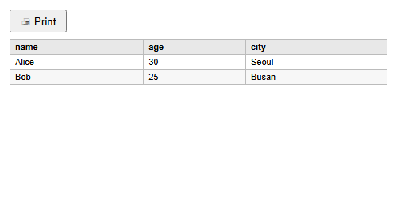

# Export & Print

CSV export and print preview both work off what the grid currently shows, filters and column order included.

Methods documented here: `exportCsv()`, `printGrid()`.

## Data Export (`exportCsv` / `printGrid`)



`exportCsv(options)` downloads the grid as a CSV file and returns a `Promise` that resolves once the
download has been started. `printGrid(options)` opens a popup window with the grid as a plain HTML
table and a **Print** button.

By default both cover only the **rows loaded so far**: the chunks the grid has fetched, plus rows
you added. `exportCsv({ full: true })` fetches every row that matches the current filter and sort
instead, asking your `fetchData` for each page (a `data` array simply has all of them already).
`printGrid()` has no `full` option, so it prints what has loaded.

A full export asks for several pages at once rather than waiting for one at a time, and uses
[`fullScanPageSize`](reference-options.md#constructor-options) as the page size when you set it. A million rows over twenty-two
columns export in about five seconds; raising `fullScanPageSize` cuts the number of round trips
your server sees. A column holding a data URI per row (an `image` column) is the one case that
stays slow, because the file itself becomes hundreds of megabytes - hide that column before
exporting if you do not need it.

`exportCsv({ full: true })` is also the way to take **every** row somewhere else. Copying with
`Ctrl+C` covers only the rows the grid is holding, since it has no values for the rest; see
[Interaction Reference](interaction.md).

| `exportCsv` option | Default | Meaning |
|---|---|---|
| `filename` | `i18n.exportCsvFilename` (`'export.csv'`) | Name of the downloaded file |
| `delimiter` | `','` | Field separator. Use `';'` for spreadsheets set to a comma decimal mark, or `'\t'` for TSV |
| `includeHeaders` | `true` | Start with a line of column labels |
| `bom` | `true` | Prefix a UTF-8 byte order mark, so Excel reads Korean, Japanese or Chinese text correctly. `false` for a plain UTF-8 file |
| `full` | `false` | Export every row that matches the filter and sort, not only loaded ones |

| `printGrid` option | Default | Meaning |
|---|---|---|
| `title` | `''` | Heading above the table, and the popup's title |
| `includeHeaders` | `true` | Show the column labels |

```js
// A CSV button. exportCsv is asynchronous when full: true, so await it.
csvBtn.addEventListener('click', async () => {
  csvBtn.disabled = true;
  try {
    await grid.exportCsv({ filename: 'users.csv', full: true });
  } finally {
    csvBtn.disabled = false;
  }
});

// A semicolon-separated file for a locale where Excel expects it.
grid.exportCsv({ filename: 'users-eu.csv', delimiter: ';' });

// Print from a click: the popup is blocked unless it starts from a user gesture.
printBtn.addEventListener('click', () => grid.printGrid({ title: 'User List' }));
```

What ends up in the file or the table:

- The columns you can see, in their current order, under their labels; hidden and deleted columns
  are left out. Rows follow the order on screen.
- The text the cells show: unsaved edits are included, and dates are written in the column's `format`.
  A rich-text cell is written without its tags.
- Rows you removed with `deleteRow(i, { permanent: true })` are left out; rows only marked for
  deletion are still on screen, so they are exported.
- A value that begins with `=`, `+`, `-`, `@`, a tab or a carriage return, and is not a plain number, gets a
  leading `'` in the CSV so a spreadsheet will not run it as a formula. Numbers such as `-5` are left
  alone.
- Lines end with `\r\n`. When only loaded rows are exported and the server has more, a console warning
  says how many were left out.
- `printGrid()` logs `popup blocked` and does nothing if the browser stops the popup.
