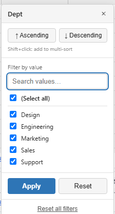
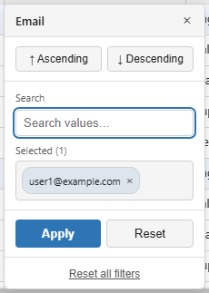
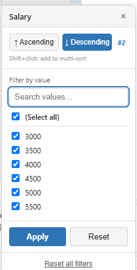

# Filtering & Sorting

Both run through the same grid state the data source sees, so a filter or a sort is one state change followed by one refetch.

**[See it running](demo.md#filtering)**

Methods documented here: `addSort()`, `clearFilters()`, `clearQuickFilter()`, `clearSorts()`, `clearSort()`, `getQuickFilter()`, `getSorts()`, `moveSort()`, `removeFilter()`, `removeSort()`, `setFilter()`, `setFilterValues()`, `setQuickFilter()`, `setSort()`, `setSorts()`.


## Set Filter / Quick Filter

Every column header has a filter icon at its right edge (it turns amber while that column has a
filter). Clicking it opens the filter / sort panel: two sort buttons, then the filter itself, then
**Apply**, **Reset** (this column) and **Reset all filters**.

The filter is a checkbox list of the column's distinct values, with a search box that narrows the
list and a **(Select all)** row. The list is built from the rows loaded so far, so on a server-paged
grid it only knows the pages it has fetched. It is offered while the column has at most 200 distinct
values; past that the panel switches to the [tag filter](#tag-filter-fetchfiltervalues) below. An
empty value is listed as `i18n.emptyCell`.



```js
grid.setFilterValues('status', ['active', 'pending']);
grid.setFilterValues('status', null); // clears the filter
```

The values are matched exactly, as text, so pass strings (`setFilterValues('level', ['1', '2'])`
for a numeric column; other values are converted with `String()`). `onFilter(filters)` reports the
result, and the same map is what a server-backed `fetchData` receives as `state.filters`.

## Tag Filter (`fetchFilterValues`)



Above that 200-value cap the column's values cannot be listed from the rows in memory, so the panel
shows a **tag picker** instead of the checklist: the user types, picks from the suggestions, and
each pick becomes a chip. Chips are combined with **OR** and applied as a `string[]`, the same
shape the checklist already sends, so `fetchData`, `getState()`, and `onFilter` need no changes.

Where the suggestions come from is what `fetchFilterValues` decides. Without it they are scanned
out of the rows already loaded, and the list says so ("From loaded rows only"). With it, the
callback answers for the whole column, which is what you want on a server-paged grid whose table
is far larger than the cache. It receives the column and the typed text and returns the matching
values, as strings, numbers or `null` (shown as an empty cell):

```js
new JHGrid({
  container: '#grid',
  fetchMeta, fetchData,
  // Called as the user types, debounced. Bound it server-side where you can (LIMIT).
  fetchFilterValues: async (field, query) => {
    const res = await fetch(`/api/distinct?col=${encodeURIComponent(field)}&q=${encodeURIComponent(query)}&limit=50`);
    return res.json();          // e.g. ['Seoul', 'Busan', 'Incheon']
  },
  onFilter: (filters) => console.log(filters),   // { city: ['Seoul', 'Busan'] }
});
```

A callback that rejects is treated as "no matches". The callback gets no `state`, so it cannot
narrow its answer by the filters already applied to other columns.

The lookup is debounced (180 ms) and waits for **two characters** (`filterValueMinChars`), whether
it runs `fetchFilterValues` or scans the loaded rows. A single character against a large column is
the most expensive query this control can issue and the least selective answer it can get; below the
threshold the panel says so and still offers the substring fallback, which needs no lookup at all.
Set it to `1` for the pre-existing behaviour.

Return however many matched; the panel builds at most 50 rows regardless and reports the rest as
"+N more, narrow the search". A one-letter query against a large column would otherwise mean
thousands of DOM nodes built on every keystroke, which is a freeze rather than a long list, and no
220px dropdown can show them anyway. A `LIMIT` on your side still saves the transfer.

Picking a value drops it into the tray, clears the box and leaves the caret there, so the next value
starts with a fresh search. The list keeps the same height whether or not any chips have been
collected yet; it is the tray below that gives way when the panel runs short of room, since chips
are what you already chose rather than what you are reading.

A column that was once too large to enumerate keeps its search box for the life of the grid. The
value scan only sees loaded rows, so a filter narrows them, and without this a column filtered down
to a handful of rows would look small enough for a checklist and swap the control out from under
whoever had just used the search to filter it.

Columns small enough to enumerate keep their checklist, which is more precise than searching.

If the typed text matches nothing the lookup knows about, the list still offers a **contains "…"**
entry that falls back to today's substring filter and arrives as a plain `string`. A column carries
exact values *or* a substring, never both; the filter map holds one value per field and the two
mean different things, so picking the fallback clears the tags and shows its own dashed chip.

Chips wrap and then scroll rather than growing the panel off-screen, and a value too long for the
panel is ellipsized with the full text in its `title`. Nothing is applied until **Apply**: filtering
is a server round trip, and committing per chip would cost one request per tag.

A global search term across all columns is handled via the quick filter. JHGrid doesn't render
its own toolbar, so build the search box UI in the host page and pass the value through this API.
Every call reloads the data, so debounce it on a server-backed grid:

```html
<input id="search" type="search" placeholder="Search all columns">
<div id="grid"></div>

<script type="module">
import { JHGrid } from '@jh-grid/jhgrid-js';

const grid = new JHGrid({ container: '#grid', data: rows });

let timer;
document.querySelector('#search').addEventListener('input', (e) => {
  clearTimeout(timer);
  timer = setTimeout(() => grid.setQuickFilter(e.target.value), 250);
});

grid.getQuickFilter();     // the current term, '' when none
grid.clearQuickFilter();   // same as setQuickFilter('')
</script>
```

The term is at most 1000 characters. What it searches is up to `fetchData`: it receives the term as
`state.quickFilter`. For a `data` array, every value of a row is searched, including keys that
have no column.

## Field-Based Filter / Sort (`setFilter` / `setSort`)

Separately from `setFilterValues()` (the Set filter UI), you can also set an arbitrary filter
condition on a single field directly from code.

```js
grid.setFilter('status', 'active');   // substring match: rows whose 'status' contains 'active'
grid.removeFilter('status');          // clear just that field's filter
grid.clearFilters();                  // clear all filters, the sort and the quick filter

grid.setSort('age', 'desc');          // sort by 'age' descending (replaces any existing sort)
grid.removeSort('age');
grid.clearSort();
```

`setSort()`, and a plain click on the filter panel's sort buttons, replace whatever sort was there.
To sort by more than one column, use the methods in
[Multi-Column Sort](#multi-column-sort-getsorts--setsorts--addsort--movesort--clearsorts) or Shift+click
the panel's buttons. `onSort(sorts)` receives the whole list, `[{ field, dir }, ...]` in priority
order, or `null` when there is no sort.

Two things to know before wiring these to buttons:

- **They ask before discarding edits.** A filter or sort change reloads the rows, so an unsaved
  edit on a server row cannot keep pointing at the same record. When such an edit exists the grid
  shows a `window.confirm()` with `i18n.unsavedEditsWarning`; cancelling leaves the filters, sort
  and edits as they were, and confirming clears the edits, delete marks, row heights and undo
  history. Edits on rows added with `addRow()` and on pinned rows are kept. Save or collect
  [`getEdits()`](reference-methods.md#getedits) first if you would rather not show the dialog. To answer the prompt
  with your own dialog instead of the browser's, pass `confirmUnsaved`:

  ```js
  new JHGrid({
    // ...
    confirmUnsaved: (message) => myConfirmSync(message),  // true discards the edits
  });
  ```

  It has to answer synchronously, because the call that asks (a header click, `setSort()`,
  `setFilter()`) is synchronous up to that point, so a modal that resolves later does not fit
  here. For that case, keep the edits out of the way yourself: read `getEdits()`, show your own
  dialog, and call `setSort()` / `setFilter()` from its callback once nothing is unsaved.
- **They validate their arguments.** A field that is not a column throws a `RangeError`, a
  non-string `field` or `value` throws a `TypeError`, and a `setFilter()` value over 1000
  characters throws a `RangeError`. Pass `null` or `''` to `setFilter()` to remove the filter.

```js
// A "Reset view" button: drop every filter and sort, then start from the first page.
resetBtn.addEventListener('click', () => grid.clearFilters());

// A status tab bar
tabs.addEventListener('click', (e) => {
  const status = e.target.dataset.status;          // 'active' | 'pending' | ''
  if (status) grid.setFilterValues('status', [status]);
  else grid.removeFilter('status');
});
```

## Multi-Column Sort (`getSorts` / `setSorts` / `addSort` / `moveSort` / `clearSorts`)

The grid never sorts rows itself: the whole key list goes to `fetchMeta`/`fetchData`
as `state.sorts`, in priority order, and your code turns it into its own `ORDER BY`. These five
methods hold and reorder that list.

```js
await grid.setSorts([{ field: 'dept', dir: 'asc' }, { field: 'salary', dir: 'desc' }]);
grid.getSorts();              // [{ field: 'dept', dir: 'asc' }, { field: 'salary', dir: 'desc' }]

await grid.addSort('score', 'desc');   // appends a third key
await grid.addSort('dept', 'desc');    // 'dept' already sorts, so this re-points it and moves it last
await grid.moveSort('score', 0);       // make 'score' the primary key
await grid.clearSorts();               // sort by nothing
```

`dir` defaults to `'asc'`. A field that is not a column (hidden columns are fine), a `dir` other than
`'asc'`/`'desc'`, the same field twice, or a `priority` that is not a non-negative integer each throw.

`setSorts`, `addSort`, `moveSort` and `clearSorts` apply through
[`setState()`](state-and-saving.md#state-snapshotrestore-getstate--setstate), so they ask the same unsaved-edit
confirmation as any other sort change and return its Promise - await it when the next step needs the
reloaded rows.

From the UI, Shift+click Asc or Desc in a header's filter panel appends that column to the current
sort instead of replacing it, and the panel shows each sorted column's priority as `#1`, `#2` and so
on. The header itself shows the same number next to its sort arrow while more than one column sorts.



What `fetchData` receives:

```js
new JHGrid({
  container: '#grid',
  fetchData: async (page, size, state) => {
    // state.sorts: [{ field: 'dept', dir: 'asc' }, { field: 'salary', dir: 'desc' }]
    const order = state.sorts.map((s) => `${s.field} ${s.dir}`).join(', ');
    const res = await fetch(`/api/rows?page=${page}&size=${size}&order=${encodeURIComponent(order)}`);
    return res.json();
  },
});
```

A host that only ever read `state.sorts[0]` keeps working, but it silently ignores the extra keys -
read the whole array.
