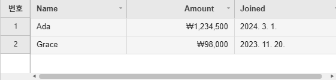

# Localization

Pick a bundled locale with `locale`, or pass your own strings through `i18n`.


## Locale / Internationalization (`locale` / `i18n`)

Setting `locale` switches both the built-in UI text pack (currently Korean/Japanese/Simplified
Chinese are bundled) and the default locale for the number/date/currency cell renderers. Use
`i18n` to override specific strings on top of that.

```js
import { JHGrid, KO_I18N } from '@jh-grid/jhgrid-js';

const grid = new JHGrid({
  container: '#grid',
  fetchMeta, fetchData,
  locale: 'ko',                 // or 'ko-KR' (defaults to 'en-US')
  i18n: { ...KO_I18N, loading: 'Loading…' }, // override specific strings only
});
```

The same grid with Korean UI text (the row-number header reads 번호, menus and panels follow) and
number/date/currency cells formatted for the locale:



```js
import { JHGrid, CellRenderers } from '@jh-grid/jhgrid-js';

const grid = new JHGrid({
  container: '#grid',
  locale: 'ko',
  data: [
    { name: 'Ada',   price: 1234500, joined: '2024-03-01' },
    { name: 'Grace', price: 98000,   joined: '2023-11-20' },
  ],
  columnDefs: [
    { field: 'name',   label: 'Name' },
    { field: 'price',  label: 'Amount', align: 'right', renderer: CellRenderers.currency({ currency: 'KRW' }) },
    { field: 'joined', label: 'Joined', renderer: CellRenderers.date({ format: 'locale' }) },
  ],
});
```

`locale` decides how amounts and dates are written, not which currency: `currency()` defaults to
`'KRW'` whatever the locale, so pass `currency` explicitly for anything other than won.

Besides the number, date and currency renderers, `locale` selects the text of the built-in messages
and menus (see the reference below). A `type: 'date'` column that sets no `format` of its own follows
it too, through the pack's `dateFormat` (`'MM/DD/YYYY'` for `en`, `'YYYY-MM-DD'` for `ko`,
`'YYYY/MM/DD'` for `ja` and `zh`). Write the column's `format` out to pin it to one pattern whatever
the locale, or ask for `format: 'locale'` to have `Intl` write the date - see
[Date Columns](cell-types.md#date-columns-type-date).

## Text Reference (`i18n`)

Every string the grid shows comes from a text pack, and `i18n` overrides individual entries. The
pack is chosen from the first part of `locale` (`'ko'`, `'ko-KR'` and `'KO'` all pick Korean);
English, Korean (`ko`), Japanese (`ja`) and Simplified Chinese (`zh`) are built in, and any other tag
falls back to English. The packs are also exported as `KO_I18N`, `JA_I18N` and `ZH_I18N` for spreading
into your own overrides. A key you leave out keeps the pack's text; a value that is a function
receives the arguments listed below.

```js
import { JHGrid, JA_I18N } from '@jh-grid/jhgrid-js';

new JHGrid({
  container: '#grid',
  data: rows,
  locale: 'ja',
  i18n: {
    ...JA_I18N,                                            // optional: the pack is applied anyway
    noData:             'Nothing to show yet.',
    validationRequired: (col) => `${col} must not be empty.`,
    pagerPageLabel:     (page, pageCount) => `${page} / ${pageCount}`,
  },
});
```

The keys, with the English text:

| Area | Key | English text / arguments |
|---|---|---|
| States | `loading` | `Loading…` |
| | `loadError` | `⚠ Failed to load data.` (banner after a request failed its retries) |
| | `noData` | `No data to display.` |
| | `emptyCell` | `Empty cell` (spoken for an empty cell, and the label of an empty value in filter lists) |
| | `ariaGrid` | `Data grid` (used when `ariaLabel` is not set) |
| | `rowNumberLabel` | `No.` (header of the row-number column) |
| Clipboard | `pasteTruncated(n)` | `n value(s) did not fit and were not pasted` |
| | `copyIncomplete(n)` | `n row(s) hadn't loaded yet and were not copied` |
| Editing | `unsavedEditsWarning` | the `confirm()` text shown before a filter or sort discards edits |
| | `editAriaLabel(col, row)` | `Edit col, row row` |
| | `richtextToolbarLabel` | `Formatting` (accessible name of the rich-text editor's toolbar) |
| Filter / sort panel | `sortAsc`, `sortDesc` | `↑ Ascending`, `↓ Descending` |
| | `sortShiftHint` | `Shift+click: add to multi-sort` |
| | `filterDialog(col)` | `col Filter` (the panel's accessible name and title) |
| | `filterLabel`, `filterPlaceholder` | `Search`, `Enter search term…` |
| | `filterApply`, `filterReset`, `filterResetAll`, `filterClose` | `Apply`, `Reset`, `Reset all filters`, `Close` |
| | `filterValuesLabel`, `filterSelectAll` | `Filter by value`, `(Select all)` |
| | `filterTagPlaceholder` | `Search values…` |
| | `filterTagLocalScope`, `filterTagNoMatch`, `filterTagAllSelected` | `From loaded rows only`, `No matching values`, `All matches already selected` |
| | `filterTagMinChars(n)`, `filterTagMore(n)` | `Type at least n characters`, `+n more - narrow the search` |
| | `filterTagSelected(n)`, `filterTagContains(q)`, `filterTagRemove(v)` | `Selected (n)`, `Contains "q"`, `Remove v` |
| Column menu | `colFreeze`, `colUnfreeze` | `Freeze columns to the left`, `Unfreeze columns to the left` |
| | `colFreezeRight`, `colUnfreezeRight` | `Freeze columns to the right`, `Unfreeze columns to the right` |
| | `colVisibility` | `Column visibility…` |
| | `colInsertLeft`, `colInsertRight` | `Insert column left`, `Insert column right` |
| | `colDelete`, `colUndelete` | `Delete column`, `Undo delete` |
| Column chooser | `colChooserTitle`, `colChooserApply`, `colChooserCancel`, `colChooserSelectAll` | `Column Visibility`, `Apply`, `Cancel`, `Select all` |
| Insert-column dialog | `colInsertTitle`, `colInsertPlaceholder` | `Add column`, `Column name` |
| | `colInsertConfirm`, `colInsertCancel` | `Add`, `Cancel` |
| Row menu | `rowInsertAbove`, `rowInsertBelow` | `Insert row above`, `Insert row below` |
| | `rowInsertTop`, `rowInsertBottom` | `Insert row at top`, `Insert row at bottom` |
| | `rowDeleteMark`, `rowDeletePermanent`, `rowDelete`, `rowUndelete` | `Mark row for deletion`, `Delete row permanently`, `Delete row`, `Undo delete` |
| | `rowPinTop`, `rowPinBottom`, `rowUnpin` | `Pin row to top`, `Pin row to bottom`, `Unpin row` (also the pin icon's tooltip) |
| | `rowHide`, `rowShowAll` | `Hide row`, `Show all hidden rows` |
| | `rowAddEnd` | `Add row` (not shown by the grid: a label for an add-row button of your own) |
| Validation | `validationRequired(col)`, `validationPattern(col)`, `validationInvalid(col)` | `col is required.`, `col format is invalid.`, `col is invalid.` |
| | `validationMin(col, min)`, `validationMax(col, max)` | `col must be at least min.`, `col must be at most max.` |
| | `validationMinLength(col, len)`, `validationMaxLength(col, len)` | `col must be at least len characters.`, `... at most len characters.` |
| Dates | `dateFormat` | `MM/DD/YYYY` (the default `format` of a `type: 'date'` column that sets none; `YYYY-MM-DD` in the `ko` pack, `YYYY/MM/DD` in `ja` and `zh`) |
| Summary row | `summaryLabel` | `Total` (the label `summaryRow` puts in `labelField` when the option sets no `label`) |
| Pager | `pagerFirst`, `pagerPrev`, `pagerNext`, `pagerLast` | `First page`, `Previous page`, `Next page`, `Last page` |
| | `pagerPageSize`, `pagerPageLabel(page, pageCount)` | `Rows per page`, `Page page of pageCount` |
| Export | `exportCsvFilename`, `printButton` | `export.csv`, `Print` |
| Screen readers | `announceCell(row, col, value)` | `Row row, col: value` |
| | `columnHeaderAnnounce(col)`, `rowHeaderAnnounce(row)` | spoken when a header or row number takes keyboard focus |
| | `sortAppliedAnnounce(col, dir)`, `filterAppliedAnnounce(col)`, `filterClearedAnnounce(col)` | spoken after the panel applies a sort or filter |
| | `allFiltersClearedAnnounce`, `rowsSelectedAnnounce(n)`, `rowReorderAnnounce(from, to)`, `rowDragOutAnnounce(from, to)` | spoken after a reset, a row selection change, a row drag-reorder, a row dragged out to another grid |
