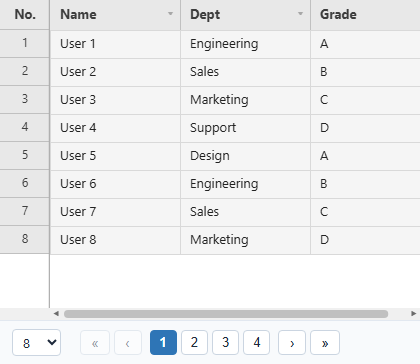
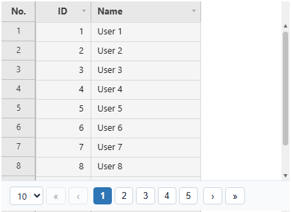
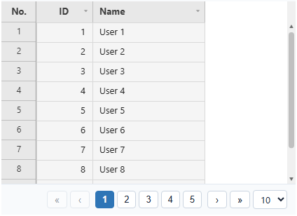

# Pagination

The default is continuous virtual scrolling; the `pagination` option switches to classic pages with a pager bar.

## Pagination

The default is continuous virtual scrolling, but setting the `pagination` option switches to a
classic page-based UI. Each page shows exactly `pageSize` rows (the last page holds the remainder), and scrolling only happens within
that page; moving to the next/previous page only happens via the auto-rendered pager bar at the
bottom (`«`, `‹`, page numbers, `›`, `»`) or via `goToPage()`/`nextPage()`/`prevPage()`.



```js
const grid = new JHGrid({
  container: '#grid',
  fetchMeta, fetchData,
  pagination: { enabled: true, pageSize: 50 },
  onPageChange: (page, pageCount) => console.log(`${page + 1} / ${pageCount}`),
});

grid.nextPage();
grid.goToPage(3);
grid.getCurrentPage(); // 0-based
grid.getPageCount();
```

The pager bar shows up to five page numbers around the current page, next to the first, previous,
next and last buttons. It sits *below* the grid, so the grid's `height` is the height of the rows
area and the container ends up a little taller than `height` (with `responsive: true` the bar is taken
out of the container's height instead). Changing page commits an open edit, clears the cell selection
and scrolls to the top of the new page. Edits you have not saved are kept, and belong to the same
absolute row indices as before.

Every public API that deals with row indices (`getEdits()`, `onCellChange`, etc.) always uses
**absolute indices relative to the entire dataset**, regardless of pagination. Pagination only
limits what's scrolled/visible at once, it never changes how rows are addressed.

## Letting users pick the page size

Add `pageSizeOptions` and the pager bar gets a page-size dropdown. The page controls (`«` `‹` page numbers
`›` `»`) always stay centered on the bar; `pageSizePosition` puts the dropdown on the `'left'` (the
default) or the `'right'`.





```js
const grid = new JHGrid({
  container: '#grid',
  fetchMeta, fetchData,
  pagination: {
    enabled: true,
    pageSize: 25,
    pageSizeOptions: [10, 25, 50, 100],
    pageSizePosition: 'right',            // 'left' (default) or 'right'
  },
  onPageSizeChange: (pageSize) => localStorage.setItem('pageSize', String(pageSize)),
});

// Start from what the user chose last time, or change it from your own control:
grid.setPageSize(Number(localStorage.getItem('pageSize')) || 25);
```

- `pageSizeOptions` takes whole numbers of at least 1. They are listed ascending, duplicates are
  dropped, and the starting `pageSize` is added if it is missing. Leave it out, or pass an empty
  array, for no dropdown.
- `pageSizePosition` is `'left'` or `'right'`; anything else means `'left'`. It only matters together with
  `pageSizeOptions`.
- The dropdown shows just the number, with no caption. Its accessible name and tooltip come from the
  grid's `locale` ("Rows per page", "페이지당 행 수", ...); `i18n.pagerPageSize` overrides that text.
- Changing the size keeps the first row of the page you were on in view: the 4th page at 50 per page
  (rows 150-199) becomes the 7th page at 25 per page, and the 2nd page at 100 per page.
- `onPageChange` also fires if the page number moved because of the new size. `getEdits()` and the
  other index-based APIs are unaffected, since indices stay absolute.
- Starting the grid from a saved size is a matter of passing it as `pageSize`; the size is not part
  of `getState()`.
