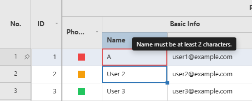

# Methods

Every public method, alphabetically, with the page that documents it. The calls that belong to no single feature are written up here.

Methods documented here: `canRedo()`, `canUndo()`, `clearEdits()`, `destroy()`, `getCellValue()`, `getCurrentPage()`, `getEdits()`, `getInvalidCells()`, `getPageCount()`, `getPageSize()`, `getRowData()`, `getTotalRows()`, `goToPage()`, `isValid()`, `nextPage()`, `prevPage()`, `ready()`, `redo()`, `refresh()`, `reloadData()`, `repaint()`, `scrollTo()`, `setCellValue()`, `setCellValues()`, `setPageSize()`, `undo()`, `validateAll()`.


## Public Methods

Every public method, and where it is documented. Methods whose behaviour is a feature in its own
right are written up under [Features](features.md#features) rather than repeated here.

| Method | Documented under |
|---|---|
| `acknowledgeChanges()` | [Batch Save (`rowKey` / `getChanges` / `acknowledgeChanges`)](state-and-saving.md#batch-save-rowkey--getchanges--acknowledgechanges) |
| `acknowledgeInsert()` | [Incremental Save (`getOriginalRowData` / `isNewRow` / `acknowledgeSave` / `acknowledgeInsert`)](state-and-saving.md#incremental-save-getoriginalrowdata--isnewrow--acknowledgesave--acknowledgeinsert) |
| `acknowledgeSave()` | [Incremental Save (`getOriginalRowData` / `isNewRow` / `acknowledgeSave` / `acknowledgeInsert`)](state-and-saving.md#incremental-save-getoriginalrowdata--isnewrow--acknowledgesave--acknowledgeinsert) |
| `addColumn()` | [Adding/Deleting/Hiding Columns (`addColumn` / `deleteColumn` / `hideColumn`)](columns.md#addingdeletinghiding-columns-addcolumn--deletecolumn--hidecolumn) |
| `addRow()` | [Adding/Deleting Rows (`addRow` / `deleteRow`)](rows.md#addingdeleting-rows-addrow--deleterow) |
| `addSort()` | [Multi-Column Sort (`getSorts` / `setSorts` / `addSort` / `moveSort` / `clearSorts`)](filtering-sorting.md#multi-column-sort-getsorts--setsorts--addsort--movesort--clearsorts) |
| `addRows()` | [Adding/Deleting Rows (`addRow` / `deleteRow`)](rows.md#addingdeleting-rows-addrow--deleterow) |
| `autoFitColumns()` | [Row Height (`setRowHeight` / `autoFitColumns`)](rows.md#row-height-setrowheight--autofitcolumns) |
| `batchStructural()` | [Changing Many Columns at Once (`batchStructural`)](columns.md#changing-many-columns-at-once-batchstructural) |
| `canRedo()` | [`undo()` / `redo()`](#undo--redo) |
| `canUndo()` | [`undo()` / `redo()`](#undo--redo) |
| `clearEdits()` | [`clearEdits()`](#clearedits) |
| `clearFilters()` | [Field-Based Filter / Sort (`setFilter` / `setSort`)](filtering-sorting.md#field-based-filter--sort-setfilter--setsort) |
| `clearQuickFilter()` | [Tag Filter (`fetchFilterValues`)](filtering-sorting.md#tag-filter-fetchfiltervalues) |
| `clearRowSelection()` | [Row Selection (`rowSelection`) / Header Checkbox](selection.md#row-selection-rowselection--header-checkbox) |
| `clearSorts()` | [Multi-Column Sort (`getSorts` / `setSorts` / `addSort` / `moveSort` / `clearSorts`)](filtering-sorting.md#multi-column-sort-getsorts--setsorts--addsort--movesort--clearsorts) |
| `clearSort()` | [Field-Based Filter / Sort (`setFilter` / `setSort`)](filtering-sorting.md#field-based-filter--sort-setfilter--setsort) |
| `commitColumns()` | [Adding/Deleting/Hiding Columns (`addColumn` / `deleteColumn` / `hideColumn`)](columns.md#addingdeletinghiding-columns-addcolumn--deletecolumn--hidecolumn) |
| `deleteColumn()` | [Adding/Deleting/Hiding Columns (`addColumn` / `deleteColumn` / `hideColumn`)](columns.md#addingdeletinghiding-columns-addcolumn--deletecolumn--hidecolumn) |
| `deleteRow()` | [Adding/Deleting Rows (`addRow` / `deleteRow`)](rows.md#addingdeleting-rows-addrow--deleterow) |
| `destroy()` | [`destroy()`](#destroy) |
| `exportCsv()` | [Data Export (`exportCsv` / `printGrid`)](export.md#data-export-exportcsv--printgrid) |
| `focusCell()` | [Selection, Focus and Editing from Code (`getSelection` / `setSelection` / `focusCell` / `startEditing` / `stopEditing`)](selection.md#selection-focus-and-editing-from-code-getselection--setselection--focuscell--startediting--stopediting) |
| `getCellValue()` | [`getRowData(rowIndex)` / `ready()`](#getrowdatarowindex--ready) |
| `getChanges()` | [Batch Save (`rowKey` / `getChanges` / `acknowledgeChanges`)](state-and-saving.md#batch-save-rowkey--getchanges--acknowledgechanges) |
| `getCurrentPage()` | [`getCurrentPage()` / `getPageCount()`](#getcurrentpage--getpagecount) |
| `getDeletedColumns()` | [Adding/Deleting/Hiding Columns (`addColumn` / `deleteColumn` / `hideColumn`)](columns.md#addingdeletinghiding-columns-addcolumn--deletecolumn--hidecolumn) |
| `getDeletedRows()` | [Adding/Deleting Rows (`addRow` / `deleteRow`)](rows.md#addingdeleting-rows-addrow--deleterow) |
| `getEdits()` | [`getEdits()`](#getedits) |
| `getHeaderCheckbox()` | [Row Selection (`rowSelection`) / Header Checkbox](selection.md#row-selection-rowselection--header-checkbox) |
| `getHiddenRows()` | [Hiding Rows (`hideRow` / `showRow` / `showAllRows`)](rows.md#hiding-rows-hiderow--showrow--showallrows) |
| `getRowDataByKey()` | [Rows by key](state-and-saving.md#rows-by-their-key-getrowindexbykey--getrowdatabykey--setcellvaluebykey) |
| `getRowIndexByKey()` | [Rows by key](state-and-saving.md#rows-by-their-key-getrowindexbykey--getrowdatabykey--setcellvaluebykey) |
| `getSummaryRowIndex()` | [Summary Row](rows.md#summary-row-summaryrow) |
| `getSummaryStats()` | [Summary Row](rows.md#summary-row-summaryrow) |
| `getSummaryValues()` | [Summary Row](rows.md#summary-row-summaryrow) |
| `getTheme()` | [Changing the Theme at Runtime](theming.md#changing-the-theme-at-runtime-settheme--gettheme) |
| `hideRow()` | [Hiding Rows (`hideRow` / `showRow` / `showAllRows`)](rows.md#hiding-rows-hiderow--showrow--showallrows) |
| `hideRows()` | [Hiding Rows (`hideRow` / `showRow` / `showAllRows`)](rows.md#hiding-rows-hiderow--showrow--showallrows) |
| `isRowHidden()` | [Hiding Rows (`hideRow` / `showRow` / `showAllRows`)](rows.md#hiding-rows-hiderow--showrow--showallrows) |
| `refreshSummary()` | [Summary Row](rows.md#summary-row-summaryrow) |
| `setCellValueByKey()` | [Rows by key](state-and-saving.md#rows-by-their-key-getrowindexbykey--getrowdatabykey--setcellvaluebykey) |
| `setDataSource()` | [Changing the Data Source at Runtime](data-source.md#changing-the-data-source-at-runtime-setdatasource) |
| `setSummaryValues()` | [Summary Row](rows.md#summary-row-summaryrow) |
| `setTheme()` | [Changing the Theme at Runtime](theming.md#changing-the-theme-at-runtime-settheme--gettheme) |
| `showAllRows()` | [Hiding Rows (`hideRow` / `showRow` / `showAllRows`)](rows.md#hiding-rows-hiderow--showrow--showallrows) |
| `showRow()` | [Hiding Rows (`hideRow` / `showRow` / `showAllRows`)](rows.md#hiding-rows-hiderow--showrow--showallrows) |
| `getHiddenColumns()` | [Adding/Deleting/Hiding Columns (`addColumn` / `deleteColumn` / `hideColumn`)](columns.md#addingdeletinghiding-columns-addcolumn--deletecolumn--hidecolumn) |
| `getInvalidCells()` | [`isValid()` / `getInvalidCells()` / `validateAll()`](#isvalid--getinvalidcells--validateall) |
| `getNewColumns()` | [Adding/Deleting/Hiding Columns (`addColumn` / `deleteColumn` / `hideColumn`)](columns.md#addingdeletinghiding-columns-addcolumn--deletecolumn--hidecolumn) |
| `getNewRows()` | [Adding/Deleting Rows (`addRow` / `deleteRow`)](rows.md#addingdeleting-rows-addrow--deleterow) |
| `getOriginalRowData()` | [Incremental Save (`getOriginalRowData` / `isNewRow` / `acknowledgeSave` / `acknowledgeInsert`)](state-and-saving.md#incremental-save-getoriginalrowdata--isnewrow--acknowledgesave--acknowledgeinsert) |
| `getPageCount()` | [`getCurrentPage()` / `getPageCount()`](#getcurrentpage--getpagecount) |
| `getPageSize()` | [`setPageSize(n)` / `getPageSize()`](#setpagesizen--getpagesize) |
| `getPinnedRows()` | [Pinned Rows (`pinnedTopRows` / `pinnedBottomRows` / `pinRow`)](rows.md#pinned-rows-pinnedtoprows--pinnedbottomrows--pinrow) |
| `getQuickFilter()` | [Tag Filter (`fetchFilterValues`)](filtering-sorting.md#tag-filter-fetchfiltervalues) |
| `getRemovedRows()` | [Adding/Deleting Rows (`addRow` / `deleteRow`)](rows.md#addingdeleting-rows-addrow--deleterow) |
| `getRowData()` | [`getRowData(rowIndex)` / `ready()`](#getrowdatarowindex--ready) |
| `getRowHeight()` | [Row Height (`setRowHeight` / `autoFitColumns`)](rows.md#row-height-setrowheight--autofitcolumns) |
| `getSelectedRows()` | [Row Selection (`rowSelection`) / Header Checkbox](selection.md#row-selection-rowselection--header-checkbox) |
| `getSelection()` | [Selection, Focus and Editing from Code (`getSelection` / `setSelection` / `focusCell` / `startEditing` / `stopEditing`)](selection.md#selection-focus-and-editing-from-code-getselection--setselection--focuscell--startediting--stopediting) |
| `getSorts()` | [Multi-Column Sort (`getSorts` / `setSorts` / `addSort` / `moveSort` / `clearSorts`)](filtering-sorting.md#multi-column-sort-getsorts--setsorts--addsort--movesort--clearsorts) |
| `getState()` | [State Snapshot/Restore (`getState` / `setState`)](state-and-saving.md#state-snapshotrestore-getstate--setstate) |
| `getTotalRows()` | [`getRowData(rowIndex)` / `ready()`](#getrowdatarowindex--ready) |
| `goToPage()` | [`goToPage(page)` / `nextPage()` / `prevPage()`](#gotopagepage--nextpage--prevpage) |
| `hideColumn()` | [Adding/Deleting/Hiding Columns (`addColumn` / `deleteColumn` / `hideColumn`)](columns.md#addingdeletinghiding-columns-addcolumn--deletecolumn--hidecolumn) |
| `isColumnVisible()` | [Adding/Deleting/Hiding Columns (`addColumn` / `deleteColumn` / `hideColumn`)](columns.md#addingdeletinghiding-columns-addcolumn--deletecolumn--hidecolumn) |
| `isNewRow()` | [Incremental Save (`getOriginalRowData` / `isNewRow` / `acknowledgeSave` / `acknowledgeInsert`)](state-and-saving.md#incremental-save-getoriginalrowdata--isnewrow--acknowledgesave--acknowledgeinsert) |
| `isRowPinned()` | [Pinned Rows (`pinnedTopRows` / `pinnedBottomRows` / `pinRow`)](rows.md#pinned-rows-pinnedtoprows--pinnedbottomrows--pinrow) |
| `isValid()` | [`isValid()` / `getInvalidCells()` / `validateAll()`](#isvalid--getinvalidcells--validateall) |
| `listenerCount()` | [Subscribing at runtime (`on` / `off`)](reference-callbacks.md#subscribing-at-runtime-on--off) |
| `moveRow()` | [Moving a Row from Code (`moveRow`)](rows.md#moving-a-row-from-code-moverow) |
| `moveSort()` | [Multi-Column Sort (`getSorts` / `setSorts` / `addSort` / `moveSort` / `clearSorts`)](filtering-sorting.md#multi-column-sort-getsorts--setsorts--addsort--movesort--clearsorts) |
| `nextPage()` | [`goToPage(page)` / `nextPage()` / `prevPage()`](#gotopagepage--nextpage--prevpage) |
| `off()` | [Subscribing at runtime (`on` / `off`)](reference-callbacks.md#subscribing-at-runtime-on--off) |
| `on()` | [Subscribing at runtime (`on` / `off`)](reference-callbacks.md#subscribing-at-runtime-on--off) |
| `pinRow()` | [Pinned Rows (`pinnedTopRows` / `pinnedBottomRows` / `pinRow`)](rows.md#pinned-rows-pinnedtoprows--pinnedbottomrows--pinrow) |
| `prevPage()` | [`goToPage(page)` / `nextPage()` / `prevPage()`](#gotopagepage--nextpage--prevpage) |
| `printGrid()` | [Data Export (`exportCsv` / `printGrid`)](export.md#data-export-exportcsv--printgrid) |
| `ready()` | [`getRowData(rowIndex)` / `ready()`](#getrowdatarowindex--ready) |
| `redo()` | [`undo()` / `redo()`](#undo--redo) |
| `refresh()` | [`refresh()`](#refresh) |
| `reloadData()` | [`reloadData()`](#reloaddata) |
| `removeFilter()` | [Field-Based Filter / Sort (`setFilter` / `setSort`)](filtering-sorting.md#field-based-filter--sort-setfilter--setsort) |
| `removeSort()` | [Field-Based Filter / Sort (`setFilter` / `setSort`)](filtering-sorting.md#field-based-filter--sort-setfilter--setsort) |
| `repaint()` | [`repaint()`](#repaint) |
| `reserveRowSpace()` | [Space Under a Row (`reserveRowSpace` / `getRowRect`)](rows.md#space-under-a-row-reserverowspace--getrowrect) |
| `getReservedRowSpace()` | [Space Under a Row (`reserveRowSpace` / `getRowRect`)](rows.md#space-under-a-row-reserverowspace--getrowrect) |
| `getReservedRows()` | [Space Under a Row (`reserveRowSpace` / `getRowRect`)](rows.md#space-under-a-row-reserverowspace--getrowrect) |
| `getRowChanges()` | [A Row's Edits, Before and After (`getRowChanges`)](rows.md#a-rows-edits-before-and-after-getrowchanges) |
| `getRowRect()` | [Space Under a Row (`reserveRowSpace` / `getRowRect`)](rows.md#space-under-a-row-reserverowspace--getrowrect) |
| `getViewportRect()` | [Space Under a Row (`reserveRowSpace` / `getRowRect`)](rows.md#space-under-a-row-reserverowspace--getrowrect) |
| `revertRow()` | [Undoing One Row's Edits (`revertRow`)](state-and-saving.md#undoing-one-rows-edits-revertrow) |
| `resetRowHeight()` | [Row Height (`setRowHeight` / `autoFitColumns`)](rows.md#row-height-setrowheight--autofitcolumns) |
| `scrollTo()` | [`scrollTo(rowIndex)`](#scrolltorowindex) |
| `setCellValue()` | [`setCellValue(row, field, value)`](#setcellvaluerow-field-value) |
| `setCellValues()` | [`setCellValues(entries)`](#setcellvaluesentries) |
| `setFilter()` | [Field-Based Filter / Sort (`setFilter` / `setSort`)](filtering-sorting.md#field-based-filter--sort-setfilter--setsort) |
| `setFilterValues()` | [Set Filter / Quick Filter](filtering-sorting.md#set-filter--quick-filter) |
| `setHeaderCheckbox()` | [Row Selection (`rowSelection`) / Header Checkbox](selection.md#row-selection-rowselection--header-checkbox) |
| `setOptions()` | [Context menus (`rowContextMenuItems` / `colContextMenuItems` / `cellContextMenuItems` / `setOptions`)](context-menus.md#context-menus-rowcontextmenuitems--colcontextmenuitems--cellcontextmenuitems--setoptions) |
| `setPageSize()` | [`setPageSize(n)` / `getPageSize()`](#setpagesizen--getpagesize) |
| `setPinnedRows()` | [Pinned Rows (`pinnedTopRows` / `pinnedBottomRows` / `pinRow`)](rows.md#pinned-rows-pinnedtoprows--pinnedbottomrows--pinrow) |
| `setQuickFilter()` | [Tag Filter (`fetchFilterValues`)](filtering-sorting.md#tag-filter-fetchfiltervalues) |
| `setRowHeight()` | [Row Height (`setRowHeight` / `autoFitColumns`)](rows.md#row-height-setrowheight--autofitcolumns) |
| `setSelection()` | [Selection, Focus and Editing from Code (`getSelection` / `setSelection` / `focusCell` / `startEditing` / `stopEditing`)](selection.md#selection-focus-and-editing-from-code-getselection--setselection--focuscell--startediting--stopediting) |
| `setSort()` | [Field-Based Filter / Sort (`setFilter` / `setSort`)](filtering-sorting.md#field-based-filter--sort-setfilter--setsort) |
| `setSorts()` | [Multi-Column Sort (`getSorts` / `setSorts` / `addSort` / `moveSort` / `clearSorts`)](filtering-sorting.md#multi-column-sort-getsorts--setsorts--addsort--movesort--clearsorts) |
| `setState()` | [State Snapshot/Restore (`getState` / `setState`)](state-and-saving.md#state-snapshotrestore-getstate--setstate) |
| `showColumn()` | [Adding/Deleting/Hiding Columns (`addColumn` / `deleteColumn` / `hideColumn`)](columns.md#addingdeletinghiding-columns-addcolumn--deletecolumn--hidecolumn) |
| `startEditing()` | [Selection, Focus and Editing from Code (`getSelection` / `setSelection` / `focusCell` / `startEditing` / `stopEditing`)](selection.md#selection-focus-and-editing-from-code-getselection--setselection--focuscell--startediting--stopediting) |
| `stopEditing()` | [Selection, Focus and Editing from Code (`getSelection` / `setSelection` / `focusCell` / `startEditing` / `stopEditing`)](selection.md#selection-focus-and-editing-from-code-getselection--setselection--focuscell--startediting--stopediting) |
| `togglePinRow()` | [Pinned Rows (`pinnedTopRows` / `pinnedBottomRows` / `pinRow`)](rows.md#pinned-rows-pinnedtoprows--pinnedbottomrows--pinrow) |
| `undeleteColumn()` | [Adding/Deleting/Hiding Columns (`addColumn` / `deleteColumn` / `hideColumn`)](columns.md#addingdeletinghiding-columns-addcolumn--deletecolumn--hidecolumn) |
| `undeleteRow()` | [Adding/Deleting Rows (`addRow` / `deleteRow`)](rows.md#addingdeleting-rows-addrow--deleterow) |
| `undo()` | [`undo()` / `redo()`](#undo--redo) |
| `unpinRow()` | [Pinned Rows (`pinnedTopRows` / `pinnedBottomRows` / `pinRow`)](rows.md#pinned-rows-pinnedtoprows--pinnedbottomrows--pinrow) |
| `JHGrid.use()` (static) | [Plugins (`JHGrid.use`)](reference-options.md#plugins-jhgriduse) |
| `validateAll()` | [`isValid()` / `getInvalidCells()` / `validateAll()`](#isvalid--getinvalidcells--validateall) |

---

## `refresh()`
Starts over: reloads the data from the first row and throws away everything the grid was holding on
to. That includes unsaved edits, filters, sorts, the quick filter, selection, undo history, row
heights, column widths and order, columns added or deleted with `addColumn()`/`deleteColumn()`, and
rows added or removed with `addRow()`/`deleteRow()`. Use it for "reload this screen from
scratch"; to pick up changed data while keeping the user's view, use
[`reloadData()`](#reloaddata) instead. It does not ask for confirmation, so check
`getEdits()` first if there may be unsaved work.

```js
grid.refresh();
```

## `reloadData()`
Re-runs `fetchMeta`/`fetchData` against the *current* filter and sort, for when the host changed the
data behind the grid (a row removed, rows appended, a server push) and wants the grid to follow
without starting over. Unlike `refresh()`, filters, sort and column state (order, widths, hidden
columns) survive, and the scroll position is kept by default. Selection, unsaved edits and the undo
history are cleared, the same as when a filter or sort changes, because a reload can shift row
indices. Returns a `Promise` that resolves once the new rows are in.

Unlike a filter or sort change, `reloadData()` does not ask for confirmation before it drops
unsaved edits, so save or collect them first. Rows added with `addRow()` and everything on
[pinned rows](rows.md#pinned-rows-pinnedtoprows--pinnedbottomrows--pinrow) survive it, and it works the same
for a `data` array (which it re-reads).

```js
await fetch('/api/rows/42', { method: 'DELETE' });
await grid.reloadData();                        // stays where it was, filters and sort intact

await grid.reloadData({ keepScroll: false });   // also jumps back to the top
```

## `repaint()`
Schedules a redraw without touching data, scroll position, edits, filters, or sort, for when
something a `cellBackground`/`rowHighlighter`/`cellDecorator` callback reads changed *outside*
the grid (some other host state) and the next frame needs to reflect it. Much cheaper than
`refresh()` when the underlying data hasn't actually changed.

```js
someExternalFlag = true;
grid.repaint(); // cellBackground etc. re-evaluate on the next frame
```

## `scrollTo(rowIndex)`
Scrolls to the specified row. If `pagination` is enabled, first switches to the page that row belongs to.

```js
grid.scrollTo(5000);
```

## `goToPage(page)` / `nextPage()` / `prevPage()`
Only works when the `pagination` option is enabled. `goToPage()` clamps the value to a valid page range.

```js
grid.goToPage(2);
grid.nextPage();
grid.prevPage();
```

## `getCurrentPage()` / `getPageCount()`
Returns the current 0-based page number and the total page count. Returns `0` and `1`, respectively, when `pagination` is disabled.

## `setPageSize(n)` / `getPageSize()`
Changes the rows per page while the grid is running, and reads it back. Only works when the `pagination` option is enabled (`setPageSize()` is otherwise a no-op and `getPageSize()` returns `0`). The first row of the page being viewed stays on screen, so the page number is recomputed for the new size; selection is cleared, as on any page change. A size that is not in `pageSizeOptions` is added to the dropdown. Throws a `TypeError` unless `n` is a whole number of at least `1`. See [Pagination](pagination.md#pagination).

```js
grid.setPageSize(100);
grid.getPageSize(); // 100
```

## `getEdits()`
Returns the cell values that were edited and not yet saved, as `{ rowIndex: { field: value } }`.
Use this when saving/sending to the server.

- Every value is a **string**, whatever the column holds: a number typed into a cell is `'25'`, a
  cleared cell is `''`, a checkbox is `'true'`/`'false'`.
- `rowIndex` is the row's current position in the grid (a row inserted above it moves it down),
  and it counts edits on rows added with `addRow()` and on pinned rows too. To tell a new row
  from a server row use [`isNewRow()`](state-and-saving.md#incremental-save-getoriginalrowdata--isnewrow--acknowledgesave--acknowledgeinsert),
  and to get the whole row with the edits applied use [`getRowData()`](#getrowdatarowindex--ready).
- With pagination on, indices are still absolute across the whole dataset.
- Sorting, filtering, `refresh()` and `reloadData()` re-arrange rows, so they clear the edits
  (after asking, if a server row has one); read them first.

```js
const edits = grid.getEdits();
// { 42: { name: 'New Name' }, 100: { age: '25' } }
await fetch('/api/save', { method: 'POST', body: JSON.stringify(edits) });
```

To send each changed row with its key instead of its position:

```js
const changes = Object.entries(grid.getEdits()).map(([row, fields]) => ({
  id:     grid.getOriginalRowData(Number(row))?.id,   // the row's key before any edit
  fields,                                             // { name: 'New Name' }
}));
await fetch('/api/save', {
  method: 'POST',
  headers: { 'Content-Type': 'application/json' },
  body: JSON.stringify(changes),
});
grid.clearEdits();
```

## `clearEdits()`
Clears all edits (restores the original data) and empties the undo history. Call it after a
successful save when you are not reloading the data. Rows added with `addRow()` and delete marks are
not touched.

```js
grid.clearEdits();
```

## `setCellValue(row, field, value)`
Programmatically sets a cell value, going through the same edit/validation/undo/`onCellChange`
path as a normal edit (checkbox toggle, paste, fill). Useful when one column's value needs to be
updated from another column (e.g. a button column toggling a checkbox column's value). Throws if
`row` is not an existing row (an index within the grid, or an encoded [pinned-row](rows.md#pinned-rows-pinnedtoprows--pinnedbottomrows--pinrow)
index), if `field`/`value` is not a string, or if `field` is not an existing column.

```js
grid.setCellValue(3, 'active', 'false'); // sets row 3's 'active' column to 'false'
```

## `setCellValues(entries)`
Bulk counterpart to `setCellValue()`, applies every entry through the same edit/validation/undo
pipeline as a single edit/undo step and one redraw, instead of one redraw per cell. Use this for
large-scale updates (e.g. a header checkbox toggling every currently-filtered row) where looping
`setCellValue()` would redraw once per row. Throws under the same conditions as `setCellValue()`.

```js
grid.setCellValues([
  { row: 0, field: 'active', value: 'true' },
  { row: 1, field: 'active', value: 'true' },
  { row: 2, field: 'active', value: 'true' },
]);
```

> **Performance note:** even batched, this still runs the full edit/validation pipeline once per
> entry. Applying it to a very large number of rows at once (hundreds of thousands or more) can
> take a long time and block the main thread while it runs; see the performance note under
> [`Delete`](interaction.md) for a concrete measurement of the same underlying cost at that scale.

## `undo()` / `redo()`
Undoes or redoes the most recent action (cell edit, paste/fill/clear, row/column add/delete, column
hide/show/resize/reorder/auto-fit, row-height drag-resize, pin/unpin, `setState()`). The history
keeps the last 100 actions, and one paste, fill or clear counts as a single step.
Also works via `Ctrl+Z` (undo) / `Ctrl+Y` or `Ctrl+Shift+Z` (redo). Use `canUndo()` / `canRedo()`
to check availability. Applying a sort/filter (`setFilter`/`setSort`/`clearFilters`, etc.) or
calling `refresh()` re-arranges row indices, so the undo/redo history is automatically cleared.

The keys can be switched off individually with the `keyboardShortcuts` option:

```js
new JHGrid({
  // ...
  keyboardShortcuts: { delete: false, undo: false }, // omitted keys stay on
});
```

Supported keys are `delete` (`Delete`/`Backspace` clearing the selected cells), `cut` (`Ctrl+X`
copying the selection and then clearing it), `undo` (`Ctrl+Z`) and `redo` (`Ctrl+Y` / `Ctrl+Shift+Z`). Only the keyboard is affected: `undo()`/`redo()` keep working when
called from code, and clearing cells through the context menu or the API is unchanged. A switched-off
key is not handled and not `preventDefault`ed, so a `keydown` listener of your own on the container can
claim it. An unknown key logs a warning and is ignored; a non-object value throws a `TypeError`.

```js
grid.undo();
grid.redo();
if (grid.canUndo()) { /* ... */ }
```

## `isValid()` / `getInvalidCells()` / `validateAll()`
Checks for violations of a column's declared `validation` rules. Automatically checked whenever
an edit is committed, and shown with a red border (plus an error-message tooltip on hover).
`validateAll()` is meant for a one-shot bulk check before saving, and, like `autoFitColumns()`/
`printGrid()`, only checks currently loaded (cached) rows.

```js
const grid = new JHGrid({
  container: '#grid',
  fetchMeta, fetchData,
  editableCols: '*',
  columnDefs: [
    { field: 'email', validation: { required: true, pattern: /^\S+@\S+\.\S+$/ } },
    { field: 'age',   validation: { min: 0, max: 120 } },
    { field: 'code',  validation: { validator: (v) => v.startsWith('A') || 'Code must start with A.' } },
  ],
});

saveBtn.addEventListener('click', async () => {
  grid.validateAll();
  if (!grid.isValid()) {
    alert('Please check your input.');
    console.log(grid.getInvalidCells()); // { 3: { email: '...' } }
    return;
  }
  await fetch('/api/save', { method: 'POST', body: JSON.stringify(grid.getEdits()) });
});
```

`validation.pattern` accepts a `RegExp` or a string (compiled once). A string that is not a valid
regular expression is reported once in the console and that rule is skipped; the other rules still
apply. The pattern runs on whatever users type or paste, so avoid patterns prone to catastrophic
backtracking (nested quantifiers such as `(a+)+`), and never build one from untrusted input.



## `getRowData(rowIndex)` / `ready()`

```js
grid.getRowData(3);            // row 3's current data (with unsaved edits applied; null if not loaded)
grid.getCellValue(3, 'name');  // one cell of it, same rules; null for an unknown field
grid.getTotalRows();           // rows the grid is showing right now, filters applied
await grid.ready();            // waits until the initial metadata/first chunk load completes
```

`getTotalRows()` counts what the grid shows: the filtered total, rows added with
[`addRow()`](rows.md#addingdeleting-rows-addrow--deleterow) included and rows removed excluded, pinned copies
aside. With pagination on it is the whole dataset, not the current page.

## `destroy()`
Fully removes event listeners and DOM. Call this when unmounting a component or navigating away.

```js
grid.destroy();
```
---
