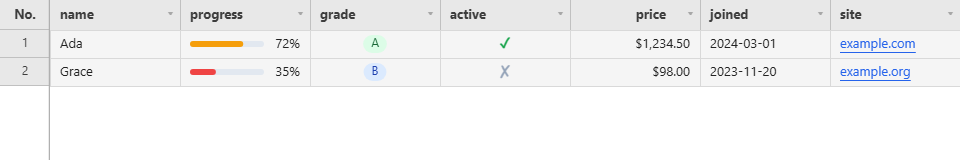
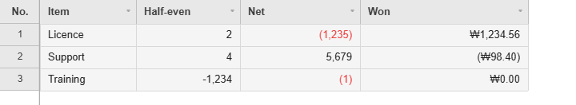
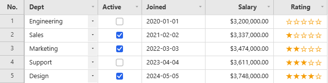
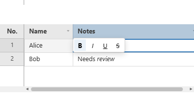
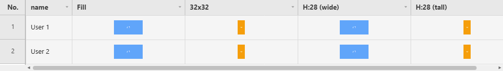

# Renderers & Custom Editors

When a built-in cell type is not enough: the bundled renderers, the three richer column types, and the two functions you write to take over drawing and editing.

**[See it running](demo.md#column-types--renderers)**


## Built-in Cell Renderers (`CellRenderers`)

Assign any of these to `columnDefs[i].renderer` (either the string key or a call to the factory
directly; both are equivalent, but calling it yourself lets you pass options):

```js
import { CellRenderers } from '@jh-grid/jhgrid-js';

columnDefs: [
  { field: 'progress', renderer: CellRenderers.progressBar({ max: 100, showLabel: true }) },
  { field: 'grade',    renderer: CellRenderers.badge({ colorMap: { A: { bg: '#dcfce7', fg: '#166534' } } }) },
]
```

| Renderer | Options | Description |
|---|---|---|
| `progressBar({ max?, showLabel? })` | `max` (default `100`), `showLabel` (default `true`) | A filled bar sized to `value / max`, with an optional percentage label |
| `badge({ colorMap? })` | `colorMap: Record<value, {bg?, fg?}>` | A pill-shaped tag per distinct value, colored per `colorMap` (falls back to a neutral gray for values not listed) |
| `checkmark({ trueColor?, falseColor?, showFalse? })` | `trueColor` (default `#16a34a`), `falseColor` (default `#94a3b8`), `showFalse` (default `true`: draw a ✗ for a false-y value; `false` leaves it blank) | A ✓/✗ glyph instead of raw `'true'`/`'false'` text. Counts as ✓: `true`, `1`, `'true'`, `'Y'`, `'예'`; anything else is ✗ |
| `image({ fit?, radius?, size?, align? })` | `fit: 'cover' \| 'contain'` (default `'cover'`), `radius` (corner radius, px), `size` (fixed box in px, see below), `align: 'center' \| 'left' \| 'right'` (default `'center'`, placement of a fixed-`size` box) | Renders the cell value as an image URL: see the `type: 'image'` note below for caching/decoding details |
| `number({ locale?, decimals?, rounding?, negative?, negativeColor? })` | BCP-47 `locale`, fixed `decimals` (default `0`), `rounding`, `negative`, `negativeColor` (see [Money columns](#money-columns-rounding-and-negatives)) | `Intl.NumberFormat`-based number formatting |
| `date({ format?, locale?, dateStyle?, align? })` | `format` (default `'YYYY-MM-DD'`): a `YYYY`/`MM`/`DD`/`HH`/`mm`/`ss` pattern, or `'locale'` to format via `Intl.DateTimeFormat`; `dateStyle`: `'full' \| 'long' \| 'medium' \| 'short'` for `'locale'`; `align` (default `'left'`) | Date formatting: pattern-based by default, locale-aware when `format: 'locale'` |
| `currency({ locale?, currency?, decimals?, rounding?, negative?, negativeColor? })` | BCP-47 `locale`, ISO 4217 `currency` code (default `'KRW'`, so pass `currency: 'USD'` etc. explicitly), `decimals` overriding the currency's own digit count, plus the same money options as `number` | `Intl.NumberFormat`-based currency formatting |
| `link({ color?, mutedColor?, underline?, align?, linked? })` | `linked`: `true` (default) or `(rowData) => boolean`; `color` (default `#2563eb`), `mutedColor`, `underline` (default `true`), `align` (default `'left'`) | Draws the cell as a link - coloured, underlined, ellipsized to fit. `linked` decides per row whether it looks (and so, paired with `onCellDoubleClick`, behaves) as one |
| `dropdown({ placeholder? })` | placeholder text for an empty value | Current value + a `▾` arrow, matching the dropdown editor's affordance |
| `multiselect({ placeholder? })` | placeholder text for an empty selection | Selected values joined + a `▾` arrow |
| `checkbox({ checkedColor?, size? })` | box color (default `#2563eb`) and size in px (default `14`) | A checked/unchecked box glyph. Counts as checked: `true`, `1`, `'true'`, `'1'`, `'Y'`, `'yes'` |
| `radio({ options?, align?, checkedColor? })` | `options` as a `dropdown` takes them (or a function of the row), `align` (default `'left'`), `checkedColor` (default `#2563eb`) | The options as circles inside the cell, one click away from being chosen; labels drop out and the circles close up as the column narrows - see [Radio Columns](cell-types.md#radio-columns-type-radio) |
| `button({ label?, disabled?, variant? })` | same shape as `columnDefs[i].button` (see [Button Columns](cell-types.md#button-columns-type-button)); defaults: `label` `'Button'`, `variant` `'primary'` (`'primary'`, `'success'`, `'danger'` or `'neutral'`) | Renders the cell as a clickable button; this is what `type: 'button'` uses internally |
| `richtext()` | none | Draws the `<b>`/`<i>`/`<u>`/`<s>` markup of a `type: 'richtext'` cell as one line of styled text; this is what that type uses internally |



The grid above, in full:

```js
import { JHGrid, CellRenderers } from '@jh-grid/jhgrid-js';

const grid = new JHGrid({
  container: '#grid',
  data: [
    { name: 'Ada',   progress: 72, grade: 'A', active: 'true',  price: 1234.5,  joined: '2024-03-01', site: 'example.com' },
    { name: 'Grace', progress: 35, grade: 'B', active: 'false', price: 98,      joined: '2023-11-20', site: 'example.org' },
  ],
  columnDefs: [
    { field: 'name' },
    { field: 'progress', renderer: CellRenderers.progressBar({ showLabel: true }) },
    { field: 'grade',    renderer: CellRenderers.badge({ colorMap: {
        A: { bg: '#dcfce7', fg: '#166534' },
        B: { bg: '#dbeafe', fg: '#1e40af' },
        C: { bg: '#fef9c3', fg: '#854d0e' },
    } }) },
    { field: 'active',   renderer: CellRenderers.checkmark({ showFalse: true }) },
    { field: 'price',    align: 'right', renderer: CellRenderers.currency({ locale: 'en-US', currency: 'USD' }) },
    { field: 'joined',   renderer: CellRenderers.date({ format: 'YYYY-MM-DD' }) },
    { field: 'site',     renderer: CellRenderers.link({ linked: true }) },
  ],
});
```

A `link` cell only *looks* like a link. To make it act like one, handle the double-click yourself;
`linked` can also be a function so that only some rows look (and behave) clickable:

```js
new JHGrid({
  // ...
  columnDefs: [
    { field: 'site', renderer: CellRenderers.link({ linked: (row) => !!row?.site }) },
  ],
  onCellDoubleClick: (rowIndex, rowData, field) => {
    if (field === 'site' && rowData?.site) window.open('https://' + rowData.site, '_blank', 'noopener');
  },
});
```

`locale` on `number`/`date`/`currency` falls back to `theme.locale` (set via the top-level
`locale` constructor option) when omitted, so most grids never need to pass it per-column.

## Money Columns: Rounding and Negatives

`number` and `currency` take the same three options for an amount column, so a figure that has to
match an accounting system does not need a renderer of your own.



```js
import { JHGrid, CellRenderers } from '@jh-grid/jhgrid-js';

const grid = new JHGrid({
  container: '#grid',
  data: [
    { item: 'Licence',  amount: 2.5,     net: -1234.5,  won: 1234.56 },
    { item: 'Support',  amount: 3.5,     net: 5678.9,   won: -98.4 },
    { item: 'Training', amount: -1234.5, net: -0.5,     won: 0 },
  ],
  columnDefs: [
    { field: 'item' },
    { field: 'amount', label: 'Half-even',  renderer: CellRenderers.number({ decimals: 0, rounding: 'halfEven' }) },
    { field: 'net',    label: 'Net',        renderer: CellRenderers.number({ decimals: 0, negative: 'parens', negativeColor: '#ef4444' }) },
    { field: 'won',    label: 'Won',        renderer: CellRenderers.currency({ locale: 'ko-KR', currency: 'KRW', decimals: 2, negative: 'parens' }) },
  ],
});
```

| Option | Values | What it does |
|---|---|---|
| `rounding` | `'ceil'`, `'floor'`, `'expand'`, `'trunc'`, `'halfCeil'`, `'halfFloor'`, `'halfExpand'` (the default), `'halfEven'`, `'halfTrunc'` | The Intl rounding mode used once `decimals` cuts the figure short. `'halfEven'` is banker's rounding: 2.5 draws as `2`, 3.5 as `4` |
| `negative` | `'minus'` (default) or `'parens'` | `'parens'` writes `-1,234` as `(1,234)`, the accounting convention, for `currency` as well as `number` |
| `negativeColor` | any CSS colour | Text colour for a value below zero. Positives keep `theme.cellText` |
| `decimals` (on `currency`) | a number | Overrides the digit count the currency itself implies - KRW normally draws none, USD two |

`rounding` comes from `Intl.NumberFormat` v3, which is newer than the
[browser floor](browser-support.md) the grid supports. Where it is missing, the renderer writes one
console warning and draws with the default `'halfExpand'` rather than letting a money column round
the wrong way in silence. An unknown mode, or an unknown `negative` value, throws as the renderer is
built rather than per cell.

**Rounding is drawing, not storing.** The cell still holds what the host gave it or the user typed,
so `getEdits()`, `getChanges()` and a CSV export carry the unrounded figure. Round at the save
boundary with the column's own [`parse`](state-and-saving.md#typed-and-keyed-edits-getedits-options)
when the stored value has to be rounded too.

Totals are not drawn through a renderer, and they are exact: the
[summary row](rows.md#summary-row-summaryrow) adds a decimal column as an integer of its smallest
unit, so a column of `0.1`-type amounts totals to the figure your database computes rather than to
`0.30000000000000004`.

Clicking an already-selected `dropdown`/`multiselect` cell opens its editor immediately (no
double-click needed); see [Dropdown and Multiselect Columns](cell-types.md#dropdown-and-multiselect-columns-type-dropdown--multiselect).

Register your own under a string key with `registerCellRenderer(name, factory)` (and the editor
counterpart, `registerCellEditor`), see the custom-editor example below for the matching factory
shape. The factory is called once per column with the options you pass, and returns the function
that draws one cell. `args` carries the cell's box (`x`, `y`, `w`, `h`), `value`, `rowData`,
`rowIndex`, `colIndex`, `theme`, `padding` and `text()`.

`args.text(str, opts)` writes one line into the cell: it uses the column's own alignment, centres
the line vertically and clips it with an ellipsis at the cell edge, so a renderer that only puts
text in a cell needs no coordinates at all. `opts` takes `align`, `color`, `size`, `bold`, `font`
and `padding`. It draws only while the renderer runs; keeping it and calling it later does nothing.

```js
import { JHGrid, registerCellRenderer } from '@jh-grid/jhgrid-js';

// 0-5 as stars. No x/y arithmetic: args.text() knows the cell it is in.
registerCellRenderer('stars', () => (ctx, { value, text }) => {
  const n = Math.max(0, Math.min(5, Math.round(Number(value) || 0)));
  text('★'.repeat(n) + '☆'.repeat(5 - n), { color: '#f59e0b', size: 15 });
});

new JHGrid({
  container: '#grid',
  data: [{ name: 'Sky', rating: 4 }, { name: 'Rose', rating: 2 }],
  columnDefs: [
    { field: 'name' },
    { field: 'rating', renderer: 'stars' },
  ],
});
```



The same renderer runs on the [live demo page](demo.md#column-types--renderers)'s Rating column.

For anything beyond a line of text, draw on `ctx` with the cell box:

```js
import { JHGrid, registerCellRenderer } from '@jh-grid/jhgrid-js';

// A small colour swatch followed by the colour's text.
registerCellRenderer('swatch', ({ size = 12 } = {}) => (ctx, { x, y, w, h, value, theme, padding }) => {
  if (!value) return;
  ctx.fillStyle = String(value);
  ctx.fillRect(x + padding, y + (h - size) / 2, size, size);
  ctx.fillStyle    = theme.cellText;
  ctx.font         = `${theme.fontSize}px ${theme.fontFamily}`;
  ctx.textAlign    = 'left';
  ctx.textBaseline = 'middle';
  ctx.fillText(String(value), x + padding + size + 6, y + h / 2);
});

new JHGrid({
  container: '#grid',
  data: [{ name: 'Sky', color: '#38bdf8' }, { name: 'Rose', color: '#f43f5e' }],
  columnDefs: [
    { field: 'name' },
    { field: 'color', renderer: 'swatch' },   // or renderer: CellRenderers.swatch({ size: 14 })
  ],
});
```

A renderer runs for every visible cell on every frame, so keep it to plain canvas calls and do not
create objects or DOM in it. Registering a name that a built-in already uses replaces the built-in
and logs a warning.

## Column Types: `date` / `richtext` / `image`, and Custom Editors/Renderers

`columnDefs[i].type` supports `date`/`richtext`/`image` in addition to `checkbox`/`dropdown`/`button`.
When set, the matching editor (`CellEditors`) and display renderer (`CellRenderers`) are applied
automatically. → [Live example](demo.md#column-types--renderers)

```js
columnDefs: [
  { field: 'dob',    type: 'date', editorOptions: { min: '1900-01-01', max: '2100-12-31' } },
  { field: 'notes',  type: 'richtext' },              // bold/italic/underline/strikethrough
  { field: 'avatar', type: 'image', renderer: CellRenderers.image({ fit: 'cover' }) },
],
```

- `type: 'date'`: a masked input in the column's date pattern, or a native date input when its
  `format` is `'locale'`, and `CellRenderers.date()` for display. See
  [Date Columns](cell-types.md#date-columns-type-date).
- `type: 'richtext'`: double-clicking a cell opens a `contenteditable` editor with a bold/italic/
  underline/strikethrough toolbar. The stored value is a sanitized HTML string made up only of
  `<b>/<i>/<u>/<s>` tags, and the grid draws it on the canvas as a **single line** (line breaks,
  lists, and block elements aren't supported, to match the fixed row-height model). The stored
  value (what `getEdits()`/`getRowData()` return) keeps those tags; CSV export, `printGrid()` and
  copy-to-clipboard write the plain text with the tags removed.

  
- `type: 'image'`: interprets the cell value as an image URL and draws it with
  `CellRenderers.image()` using its defaults. To pass options (`fit`, `radius`, `size`, `align`),
  set `renderer: CellRenderers.image({ ... })` on the column; the string form `renderer: 'image'`
  takes no options. Decoding is done via `fetch()` +
  `createImageBitmap`, downscaled to cover the cell's display size while keeping the source aspect
  ratio, so memory usage stays low regardless of the source resolution, and the same URL is reused across
  grids via a page-wide LRU cache (50MB budget). Redraws automatically once the async load finishes.
- Allowed URLs: only `http:`, `https:`, `blob:` and `data:image/...` (and relative paths) are loaded.
  Any other scheme (`javascript:`, `file:`, `ftp:`, `data:text/html`, ...) is not requested and the
  cell shows the error tile. Because the grid fetches a cell's URL as soon as the cell is drawn,
  and a same-origin URL is sent with the page's cookies like a normal ``, do not put
  user-supplied URLs in an image column unless your server treats such GET requests as safe.
- Image size: by default the image fills the cell (minus padding), so it grows and shrinks with the
  column width and row height. Pass `size` to `CellRenderers.image()` to keep it a fixed size
  instead (capped to the cell, vertically centered, horizontally placed by `align`):
  - `size: 32` is a 32x32 box; `fit` decides how a non-square image sits in it (`'contain'` shows
    the whole image, `'cover'` crops).
  - `size: { width: 48, height: 32 }` sets both sides, with `fit` applied inside that box.
  - `size: { height: 32 }` (or only `width`) fixes one side and lets the other follow the image's
    own aspect ratio, so non-square images are neither stretched nor letterboxed. A square
    placeholder is shown until the image loads.

  ```js
  { field: 'avatar', type: 'image', renderer: CellRenderers.image({ size: { height: 28 }, radius: 4 }) }
  ```



The image above, in full. The 2:1 and 1:2 source images are never stretched, and only the first
column changes size with the row height:

```js
new JHGrid({
  container: '#grid',
  data: [
    { name: 'User 1', photo: '/img/u1-wide.png', avatar: '/img/u1-tall.png', banner: '/img/u1-wide.png', poster: '/img/u1-tall.png' },
    // ...
  ],
  rowHeight: 48,
  columnDefs: [
    { field: 'name' },
    { field: 'photo',  renderer: CellRenderers.image({ fit: 'contain' }) },                 // fills the cell
    { field: 'avatar', renderer: CellRenderers.image({ size: 32, fit: 'contain' }) },      // 32x32 box, whole image visible
    { field: 'banner', renderer: CellRenderers.image({ size: { height: 28 } }) },          // 28px tall, width follows the image
    { field: 'poster', renderer: CellRenderers.image({ size: { height: 28 } }) },
  ],
});
```

To build your own cell editor, assign a function to `columnDefs[i].editor`, the same way `renderer`
accepts a function:

```js
{ field: 'color', editor: (ctx) => {
    const input = document.createElement('input');
    input.type = 'color';
    input.value = ctx.initialValue || '#000000';
    ctx.cellBox({ el: input });   // positions it over the cell for you
    input.addEventListener('change', () => ctx.commit());
    return input; // any shape works as long as it has .value / .remove()
  } }
```

`ctx` carries `row`/`col`/`field`/`rowData`, position/size (`x`/`y`/`colW`/`rowH`), `theme`/`i18n`/
`columnLabel`, `initialValue` (always a string), and callbacks to notify the host grid: `commit()`/
`cancel()`/`moveSel(dr, dc)`/`focusWrapper()`. `wrapper` is the grid's root element. `insertLineBreak()`
re-opens a text editor with a line break at the caret (what `Alt+Enter` does), and `suppressReopen()`
tells the grid not to open a dropdown-style editor again when the click that just closed it landed
on the same cell. The return value only needs `.value` (a string) and `.remove()`,
so you can either return an `<input>` directly (as above) or return an object shaped like
`CellEditors.dropdown()`'s `{ get value() {...}, remove() {...} }`.

### Editor surfaces: `ctx.cellBox()` / `ctx.popup()` / `ctx.done()`

The example above positions its `<input>` by hand, which is fine for a control that covers exactly
the cell. Anything larger - an option panel, a picker, a form - has to sit outside the cell, escape
whatever `overflow: hidden` is between the grid and the page, stay put while the page scrolls, and
close on the same keys and outside clicks as every other editor. `ctx` provides all of that, so a
custom editor never computes a coordinate:

A complete one: a column that stores the chosen certificates as `'Crane,Forklift'`, edited in a panel
of checkboxes under the cell.

```js
{ field: 'certify', width: 200, editor: (ctx) => {
    ctx.cellBox();                                                  // accent border over the cell
    const panel = ctx.popup({ role: 'listbox', minWidth: 220 });    // anchored under the cell

    const chosen = new Set(String(ctx.initialValue ?? '').split(',').filter(Boolean));
    for (const name of ['Forklift', 'Crane', 'Welding']) {
      const row = document.createElement('label');
      row.style.cssText = 'display:flex;gap:8px;padding:6px 10px;cursor:pointer';
      const box = document.createElement('input');
      box.type = 'checkbox';
      box.checked = chosen.has(name);
      box.addEventListener('change', () => (box.checked ? chosen.add(name) : chosen.delete(name)));
      row.append(box, name);
      panel.append(row);
    }

    // Enter commits, Escape cancels, Tab commits and moves, a click outside commits.
    return ctx.done({ value: () => [...chosen].join(',') });
  } }
```

**`ctx.cellBox({ el, border = true, interactive })`** → a box covering exactly the cell, carrying
the same accent border the built-in editors draw. It lives inside the grid wrapper, so it tracks the
grid on its own, and it is removed with the editor.

Pass `el` to place an element you already have — a native `<input type="color">`, say — instead of
letting it make a `<div>`; that is what an editor whose control *is* its element wants, and it is how
the example above positions its input. Either way the element fills the cell, as the built-in
editors' inputs do (clear its `width`/`height` afterwards if you want its natural size).

`interactive` decides whether the box receives clicks. It defaults to `false` for a `<div>` cellBox
makes itself (its usual job is to mark the cell, not to catch anything) and to `true` when you pass
`el`, since an element handed in is there to be typed in or clicked.

**`ctx.popup(opts)`** → an empty `<div>` anchored to the cell, mounted on `<body>` with
`position: fixed` so no ancestor can clip it, and re-anchored as ancestors scroll or the window
resizes. Options:

| Option | Default | Meaning |
|---|---|---|
| `placement` | `'below'` | `'below'` / `'above'` / `'over'` the cell |
| `align` | `'left'` | which cell edge it lines up with: `'left'` / `'right'` / `'stretch'` (cell width) |
| `minWidth` | `'cell'` | `'cell'`, a number of px, or `null` |
| `maxHeight` | `240` | px, or `null` for unbounded. Scrolls past it |
| `flip` | `true` | flip to the other side of the cell when the chosen one has no room, and clamp horizontally into the viewport |
| `chrome` | `true` | apply the standard overlay background/border/shadow, matching the built-in panels |
| `role` | – | ARIA role, e.g. `'listbox'` |
| `ariaLabel` | `true` | `true` for the grid's standard "edit *column*, row *n*" label, a string for your own, `false` for none |

**`ctx.done(opts)`** → the `{ value, remove }` object the grid commits from, with the keyboard and
outside-click behaviour every built-in editor shares already wired: Enter commits, Escape cancels,
Tab commits and moves one cell (Shift+Tab backwards), and a mousedown outside commits. It also tears
down every surface the editor created, so there is nothing to clean up by hand.

| Option | Default | Meaning |
|---|---|---|
| `value` | *(required)* | `() => string` (or a plain value), read once at commit |
| `outside` | `'commit'` | what a mousedown outside the editor does: `'commit'` / `'cancel'` / `'ignore'`. The built-in single-choice dropdown uses `'cancel'` |
| `keys` | – | per-key override, e.g. `{ enter: false, escape: 'cancel' }`. Each is `'commit'`, `'cancel'`, `'commit-and-move'`, or `false` to leave the key alone |
| `onKey` | – | `(e) => boolean`, seen before the mapping above, for keys the editor handles itself (arrow navigation in a listbox, say). Return `true` to stop there. Torn down with the rest, so an editor never registers a keydown listener of its own |
| `onCommit` / `onCancel` | – | run just before the grid is told, for editor-local bookkeeping |

The returned object also exposes `commit()` and `cancel()`, for an editor that closes itself from
its own UI (an OK button, say).

> These surfaces exist on the **editor** context only, and deliberately so. A canvas grid's
> performance comes from not building DOM per cell; one edit session is alive at a time (starting
> another edit, scrolling the grid, or mousing down elsewhere all commit the current one first), so
> what they mount is bounded at one editor and its popups no matter how many rows are loaded. The
> renderer and `cellDecorator` contexts draw on the canvas and have no DOM equivalent.


You can also register reusable editors/renderers by name, so multiple columns can reference them by string key:

```js
import { registerCellEditor, registerCellRenderer, CellRenderers } from '@jh-grid/jhgrid-js';

registerCellEditor('color', (opts) => (ctx) => { /* same factory shape as above */ });
registerCellRenderer('color', () => (ctx, info) => { /* draw a color swatch on the canvas */ });

columnDefs: [{ field: 'favoriteColor', editor: 'color', renderer: 'color' }]
```
