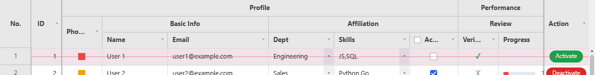
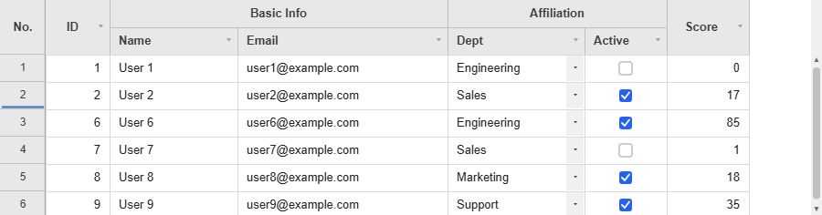
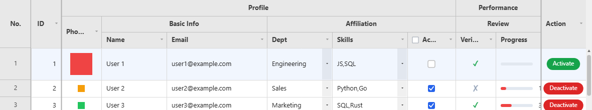
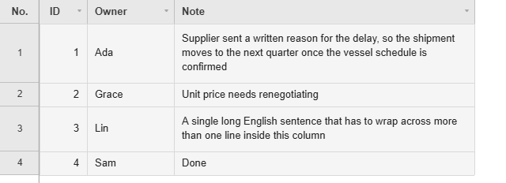
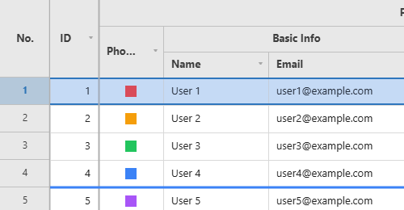
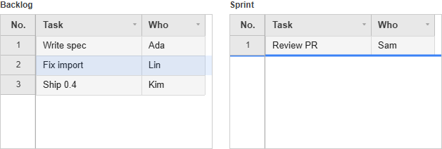
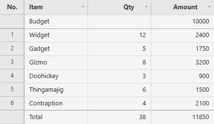
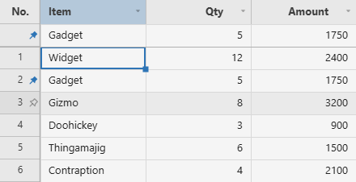

# Rows

Adding, removing, hiding, resizing and reordering rows, plus the pinned rows that stay visible above and below the scrolling area.

**[See it running](demo.md#pinned-rows)**

Methods documented here: `addRow()`, `addRows()`, `autoFitColumns()`, `deleteRow()`, `getDeletedRows()`, `getHiddenRows()`, `hideRow()`, `hideRows()`, `isRowHidden()`, `showAllRows()`, `showRow()`, `getNewRows()`, `getPinnedRows()`, `getRemovedRows()`, `getRowHeight()`, `isRowPinned()`, `pinRow()`, `resetRowHeight()`, `setPinnedRows()`, `setRowHeight()`, `togglePinRow()`, `undeleteRow()`, `unpinRow()`.


## Adding/Deleting Rows (`addRow` / `deleteRow`)



```js
grid.addRow({ name: 'New', age: 0 });        // append at the end
grid.addRow({ name: 'New' }, { index: 0 });  // insert at the front

grid.addRows([{ name: 'A' }, { name: 'B' }]);              // append a batch, returns [index, ...]
grid.addRows([{ name: 'A' }, { name: 'B' }], { index: 2 }); // A at 2, B at 3

grid.deleteRow(3);      // marks row 3 as deleted (strikethrough, undoable)
grid.undeleteRow(3);    // clears the deletion mark

grid.getNewRows();      // rows added this session, use this to send new-insert requests to the server
grid.getDeletedRows();  // server indices of rows marked for deletion (see the note below)
```

By default `deleteRow()` **marks** a server row (dims it with a strikethrough, keeps it on
screen, and reports it via `getDeletedRows()`) rather than removing it; this is the `deleteMode`
constructor option, `'mark'` by default. Pass `{ permanent: true }` (or set `deleteMode:
'permanent'` for the whole grid) to take the row off the screen immediately instead:

```js
grid.deleteRow(3, { permanent: true }); // removed from the screen right away
grid.getRemovedRows(); // server indices removed this way, separate from getDeletedRows()
grid.undeleteRow(3);   // brings a permanently-removed row back too
```

A row added via `addRow()` ignores all of this; it was never sent anywhere, so `deleteRow()` on
it just removes it outright regardless of `deleteMode`.

`addRows(rows, opts?)` inserts a whole list as **one** undo step and one redraw, which is what
calling `addRow()` in a loop does not do: a hundred calls leave a hundred undo steps behind and
redraw a hundred times. `index` places the first row and the rest follow it in order; omitted,
they all go to the end. It returns the index of each new row and ignores an empty list.

`getDeletedRows()`/`getRemovedRows()` report **server indices**, not screen positions: a row
inserted above a marked one moves it down the screen, but not in what these two report. A server
index is the row's position in the result the server returned for the filter and sort in effect
(what `page * size + i` counted in your `fetchData`), which for a `data` array with no filter or sort
is simply the index into the array.

`addRow()` returns the new row's index, and everything it does stays in the browser until you send
it. `getNewRows()` gives each added row as it was when added; edits made to it afterwards are
reported by `getEdits()` under its index (`isNewRow(index)` is `true`), and `getRowData(index)` returns
the row with them applied.

A save button that sends updated/added/deleted rows together can either assemble that payload by
hand from `getEdits()`/`getNewRows()`/`getDeletedRows()` as above, or — when rows have a stable key
(most do) — call [`getChanges()`](state-and-saving.md#batch-save-rowkey--getchanges--acknowledgechanges) instead, which
does the same assembly keyed by that column:

```js
saveBtn.addEventListener('click', async () => {
  grid.validateAll();
  if (!grid.isValid()) return alert('Fix the highlighted cells first.');

  const { updated, added, deleted } = grid.getChanges(); // requires the `rowKey` option

  const res = await fetch('/api/save', {
    method: 'POST',
    headers: { 'Content-Type': 'application/json' },
    body: JSON.stringify({ updated, created: added, deleted }),
  });
  if (res.ok) await grid.acknowledgeChanges(); // forgets the edits/adds/marks, re-reads the data
});
```

See [Batch Save](state-and-saving.md#batch-save-rowkey--getchanges--acknowledgechanges) for what each of the three
arrays looks like and the one case it doesn't cover (`deleteMode: 'permanent'` rows).

## Hiding Rows (`hideRow` / `showRow` / `showAllRows`)

Takes rows out of the view without deleting them. Right-click a row and pick **Hide row**, or call
the methods; the row-number gutter marks the boundary rows were folded away at, and the same menu
offers **Show all hidden rows** while any are hidden.

```js
grid.hideRow(3);              // the row at index 3 leaves the view
grid.hideRows([0, 2, 5]);     // one undo step for the batch, returns how many were hidden

grid.getHiddenRows();         // [{ index: 3, key: '42' }] - index is the server index, key the rowKey value
grid.isRowHidden(3);          // by server index, not by the row index on screen

grid.showRow(3);              // one row back, by the server index above
grid.showAllRows();           // everything back, returns how many
```



A hidden row leaves the grid the same way a permanently deleted one does, so **every count and
every export already leaves it out**: `getTotalRows()`, the row indexes of the rows under it, a CSV
export, and anything computed over the rows. It is not a change to save - it stays out
of `getChanges()` and `getRemovedRows()`, and rides in `getState()` with the hidden columns.

**Set `rowKey`.** A sort, a filter or a `reloadData()` re-numbers every server row, so hidden rows
are found again by their `rowKey` value as the new rows arrive. Without `rowKey` there is nothing
stable to find them by and they come back visible (with one console warning).

| | |
|---|---|
| Hidden by | the server index at the time, and the `rowKey` value where there is one |
| Survives a sort/filter/reload | with `rowKey`; without it, the rows come back |
| In `getState()` | yes, as `hiddenRows: [{ index, key }]` |
| In exports and totals | no - a hidden row is not in the view at all |
| A row added here and not saved yet | cannot be hidden (no identity to hide it by) - delete it instead |

`rowContextMenuItems` gates the menu entry under the name `'row-hide'`.
## Row Height (`setRowHeight` / `autoFitColumns`)



```js
grid.setRowHeight(3, 40);   // changes only row 3's height to 40px
grid.setRowHeight(28);      // called with one argument, changes the default row height for all rows
grid.getRowHeight(3);
grid.resetRowHeight(3);     // resets that row back to the default height

grid.autoFitColumns('name', 'age'); // auto-resizes the given columns to fit their content (all columns if no argument)
```
Like `isValid()`/`printGrid()`, `autoFitColumns()` only computes against currently loaded (cached) rows.

## Wrapped Cells and Auto Row Height (`wrapCells` / `autoRowHeight`)

`wrapCells: true` wraps a cell's text onto as many lines as the column's width needs instead of
cutting it off with an ellipsis. `autoRowHeight: true` then gives each row the height its tallest
cell needs. The two are separate options: wrapping without the height leaves the lines past the
first clipped at the row's bottom edge, with the last visible line ending in an ellipsis.

```html
<div id="my-grid" style="width: 620px; height: 250px"></div>

<script type="module">
import { JHGrid } from '@jh-grid/jhgrid-js';

const grid = new JHGrid({
  container: '#my-grid',
  wrapCells: true,
  autoRowHeight: true,
  columnDefs: [
    { field: 'id',   label: 'ID',    width: 60, align: 'right' },
    { field: 'name', label: 'Owner', width: 90 },
    { field: 'note', label: 'Note',  width: 300 },
  ],
  data: [
    { id: 1, name: 'Alice', note: 'A single long sentence that has to wrap across more than one line inside this column' },
    { id: 2, name: 'Bob',   note: 'Short' },
    { id: 3, name: 'Chloe', note: 'Line one\nline two, written with an explicit line break' },
  ],
});
</script>
```



- A word wider than the column is broken across lines, so text with no spaces in it (Korean,
  Japanese, Chinese) wraps the same way a spaced sentence does.
- Explicit line breaks in a value still break lines, with or without `wrapCells`. `autoRowHeight`
  counts them too, so a value pasted in with line breaks arrives at the right height instead of
  needing a double-click to fit.
- Heights are measured against the column widths of the moment: dragging a column narrower, calling
  [`autoFitColumns()`](#row-height-setrowheight--autofitcolumns) or a container resize under
  [`responsive`](columns.md#responsive-sizing-responsive) re-measures the rows that are loaded.
- Editing a cell re-fits its row, both ways - a longer value grows it, a shorter one gives the
  space back.
- A row you set yourself with `setRowHeight()`, or the user drags from the row-number gutter, keeps
  that height and is left out of the measuring.

**How many rows get measured.** Up to 5,000 rows, every loaded row is measured, so the total height
is exact and the scrollbar never moves on its own. Past that the grid measures a window around the
viewport instead - the rows on screen and 50 either side - and leaves the rest at the default
height, giving back the heights of rows that have scrolled far away. That keeps the row-height model
sparse (one height for every row of a million would turn each change into a sort of the whole
dataset), and the cost is the honest one: **the scrollbar shifts a little as taller rows come into
view**. If that matters more than fitted rows, leave `autoRowHeight` off above 5,000 rows and fit
the rows you need with `setRowHeight()`, or a double-click on the bottom edge of a row number.
`wrapCells` has no cap either way: it draws what is on screen, at any row count.

## Summary Row (`summaryRow`)

A grand total row pinned above or below the data, which stays put while the rows scroll.

```js
const grid = new JHGrid({
  container: '#my-grid',
  rowKey: 'id',
  summaryRow: {
    position: 'bottom',                             // 'top' | 'bottom' | 'both'
    aggregates: { salary: 'sum', score: 'avg' },    // sum | avg | min | max | count | fn(rows, field)
    label: 'Total', labelField: 'name',
  },
  data: rows,
});

grid.getSummaryValues();        // { salary: 412000000, score: 81.4 }
grid.getSummaryStats();         // { rows, missing, capped, source }
grid.getSummaryRowIndex();      // the row index it sits at
grid.setSummaryValues({ salary: 412000000 });   // totals from the server instead; null computes again
grid.refreshSummary();          // recompute now
```

- The row is an ordinary pinned row, added **after** anything the host pinned, so `pinnedTopRows`
  and `pinnedBottomRows` keep the indices they had.
- The numbers cover the rows the grid is showing, filters included. An edit, a sort, a filter or
  new rows arriving all update them. An edit is applied to the running totals rather than counting
  every row again - on 200,000 rows that is 0.02ms instead of 23ms per edit - except where the
  arithmetic cannot be undone: a `min`/`max` whose extreme value was the one edited, a function
  aggregate, or totals you supplied with `setSummaryValues()`. Those still recount, as before.
- A function aggregate gets `(rows, field)` and can return anything, text included.
- `label` goes in `labelField` (the first column by default), and defaults to the word for a total
  in the grid's `locale`.
- `background` shades the row (`'#f1f5f9'` by default, `null` leaves it unpainted). A
  `cellBackground` of your own still wins wherever it returns a colour.
- **A server-backed grid only holds the chunks it has fetched**, so a total over a half-loaded table
  would be a plausible-looking wrong number. Those are left blank, with one warning, unless
  `allowPartial: true`; `setSummaryValues()` is the path for a server that totals properly.
- Past `maxRows` (200,000 by default) nothing is totalled and `getSummaryStats().capped` says so.
- `rows` and `excludeRow` hand the choice of records to you, for a grid whose rows on screen are a
  shaped view of something you hold yourself. `rows()` returns the records to total instead of the
  rows the grid shows; `excludeRow(rowData, rowIndex)` drops a row that is on screen but is not
  data, such as a header row that already carries a subtotal of its own.

  ```js
  summaryRow: {
    aggregates: { amount: 'sum' },
    rows: () => myRecords,                   // total these, not what is on screen
    excludeRow: (row) => row.isSectionHead,   // and leave these out
  }
  ```

## Row Drag Reorder (`rowReorder`)



Drag rows by the row-number gutter to reorder them. Unlike column reordering, row data isn't
always resident in memory under server-side paging, so enabling this scans the entire dataset once
(it's an opt-in feature).

```js
const grid = new JHGrid({
  container: '#grid',
  fetchMeta, fetchData,
  rowReorder: true,
  onRowReorder: (fromIndex, toIndex, rowData) => console.log(fromIndex, '→', toIndex),
});
```

What to expect:

- After a drop the grid shows the new order at once, but only in the browser. A sort, a filter,
  `refresh()` or `reloadData()` fetches from your server again, so `onRowReorder` is where you save
  the order (`toIndex` is where the row ended up, `fromIndex` where it was).
- Like a sort, a drop discards the state keyed by row index (edits, selection, undo history), and
  asks with a `window.confirm()` first when a server row has an unsaved edit.
- Dragging starts working once the full scan has finished, so on a big dataset it is not available
  the instant the grid appears. Rows added with `addRow()` and pinned rows cannot be dragged. `fullScanPageSize` and
  `fullScanConcurrency` tune the scan.

```js
new JHGrid({
  container: '#grid',
  fetchMeta, fetchData,
  rowReorder: true,
  onRowReorder: (fromIndex, toIndex, rowData) => {
    fetch(`/api/tasks/${rowData.id}/move`, {
      method: 'POST',
      headers: { 'Content-Type': 'application/json' },
      body: JSON.stringify({ toIndex }),
    });
  },
});
```

## Space Under a Row (`reserveRowSpace` / `getRowRect`)

`reserveRowSpace(rowIndex, height)` keeps a strip under a row's cells that the grid lays out but
never draws in, and that clicks pass through. The row grows, everything below it moves down, and
the strip is yours to cover with your own element - enough on its own for an inline chart, a form,
a detail panel or a second grid under the row.

```js
const grid = new JHGrid({ container: '#grid', data: rows, columnDefs });
const panel = document.createElement('div');
panel.style.position = 'absolute';
document.querySelector('#grid').appendChild(panel);

let openRow = null;

function place() {                         // the grid redraws on scroll, sort, resize ...
  const rect = openRow == null ? null : grid.getRowRect(openRow);
  if (!rect || !rect.visible || rect.reservedHeight === 0) { panel.style.display = 'none'; return; }
  Object.assign(panel.style, {
    display: 'block',
    left:   `${rect.left}px`,
    top:    `${rect.reservedTop}px`,
    width:  `${rect.width}px`,
    height: `${rect.reservedHeight}px`,
  });
}
grid.on('render', place);                  // ... and this puts the panel back each time

function open(rowIndex) {
  if (openRow != null) grid.reserveRowSpace(openRow, 0);
  openRow = rowIndex;
  grid.reserveRowSpace(rowIndex, 180);
  panel.textContent = JSON.stringify(grid.getRowData(rowIndex));
}
```

| API | What it answers |
|---|---|
| `reserveRowSpace(rowIndex, height)` | Keeps `height` pixels under that row. `0` gives them back |
| `getReservedRowSpace(rowIndex)` / `getReservedRows()` | What is reserved where |
| `getRowRect(rowIndex)` | `{ top, height, reservedTop, reservedHeight, left, width, visible }` in pixels relative to the grid element |
| `getViewportRect()` | The scrollable band, for clipping your element so it cannot cover the header, a pinned row or the scrollbars |

What to expect:

- The strip is **not** part of the row's cells: `getRowHeight()` still reports the cell height,
  `setRowHeight()` still sets it, `autoRowHeight` still measures text as if the strip were not
  there, and an editor covers the cells only.
- Clicks in the strip do not select or edit a cell, so your element gets them.
- The row background is painted under the strip; nothing else is. Put an opaque element over it.
- A row with space reserved cannot be drag-reordered - the panel is placed from the row's index.
- Pinned rows cannot reserve space.
- The layout moves at once, so `getRowRect()` straight after the call is already correct, while the
  repaint waits for the next frame. Reserving space for twenty rows in a loop therefore costs one
  repaint, not twenty.

## A Row's Edits, Before and After (`getRowChanges`)

`getRowChanges(rowIndex)` pairs each edited field with the value it had, which is the shape an
audit entry or a "save these changes?" dialog wants. Null when that row has no unsaved edit.

```js
grid.setCellValue(3, 'qty', '99');
grid.getRowChanges(3);                  // { qty: { before: '10', after: '99' } }
grid.getRowChanges(3, { typed: true }); // { qty: { before: 10, after: 99 } }
```

`typed` runs the column's own [`parse`](state-and-saving.md#typed-and-keyed-edits-getedits-options)
on both sides, the same way `getEdits({ typed: true })` does. The two halves used to come from
different calls - `getOriginalRowData()` and `getEdits()` - and lining them up was left to you.

## Dragging Rows Between Grids (`rowDragGroup`)

Give two grids the same `rowDragGroup` name and a row can be dragged by the row-number gutter out
of one and into the other. The grid it lands on draws the drop line; the grid it came from keeps
the row shaded until the button comes up.



```js
import { JHGrid } from '@jh-grid/jhgrid-js';

const columnDefs = [{ field: 'task', label: 'Task' }, { field: 'who', label: 'Who' }];

const backlog = new JHGrid({
  container: '#backlog',
  rowDragGroup: 'tasks',
  columnDefs,
  data: [
    { task: 'Write spec', who: 'Ada' },
    { task: 'Fix import', who: 'Lin' },
  ],
});

const sprint = new JHGrid({
  container: '#sprint',
  rowDragGroup: 'tasks',
  columnDefs,
  data: [{ task: 'Review PR', who: 'Sam' }],
  onRowDropIn: ({ rowData, toIndex }) => console.log('took', rowData.task, 'at', toIndex),
});
```

The drop is made of the two public row APIs, which is what makes it saveable:

- the receiving grid runs `addRow(rowData, { index: toIndex })`, so the row shows up in **its**
  `getNewRows()` and `getChanges().added`;
- the sending grid runs `deleteRow(rowIndex)`, so the row shows up in **its** `getDeletedRows()`
  and `getChanges().deleted`. With the default `deleteMode: 'mark'` the row stays visible, struck
  through, until that grid's host saves and reloads. Set `deleteMode: 'permanent'` on the sending
  grid to have it leave the view at once.

Each host saves its own half; the grid never talks to a server for you.

| Callback | Fires on | Return value |
|---|---|---|
| `onRowDragOut({ grid, toGrid, rowIndex, rowData, toIndex })` | the grid the row is leaving | `false` calls the whole move off |
| `onRowDropIn({ grid, fromGrid, rowData, toIndex })` | the grid receiving it | `false` refuses the row; a row object is inserted in place of the one that arrived |

`onRowDropIn` returning an object is where two grids with different columns meet:

```js
onRowDropIn: ({ rowData }) => ({ title: rowData.task, assignee: rowData.who, state: 'todo' }),
```

What to expect:

- Dragging **out** does not need `rowReorder`. Only the one row travels, so the full scan that
  option starts is not involved. Set `rowReorder: true` as well when the same grid should also
  reorder within itself; then a drop inside its own canvas reorders and a drop on a sibling moves.
- Rows added with `addRow()` and not saved yet, and pinned rows, cannot be dragged - as with
  [row reorder](#row-drag-reorder-rowreorder).
- Grids with different `rowDragGroup` names ignore each other, and so does a grid with no group.
- The move is announced through the live region, in the wording of `i18n.rowDragOutAnnounce`.

## Moving a Row from Code (`moveRow`)

`moveRow(from, to)` does what the drag above does, from code. `to` is where the row ends up, so
`moveRow(5, 0)` puts row 5 first, and the number matches the `toIndex` that `onRowReorder` reports.

```js
const grid = new JHGrid({
  container: '#grid',
  fetchMeta, fetchData,
  rowReorder: true,
  onRowReorder: (fromIndex, toIndex, rowData) => saveOrder(rowData.id, toIndex),
});

document.querySelector('#to-top').addEventListener('click', async () => {
  const [row] = grid.getSelectedRows();
  if (row != null) await grid.moveRow(row, 0);
});
```

What to expect:

- It goes through the same path as the drag, so `onRowReorder` fires, the live region announces the
  move, and the state keyed by row index (edits, selection, undo history) is discarded. An unsaved
  edit on a server row asks with `window.confirm()` first; keeping the edit leaves the order as it
  was and the call answers `false`.
- It needs `rowReorder: true`, and awaiting it covers the full scan that option starts - so on a
  large server-backed grid the **first** call takes as long as that scan and the ones after it are
  immediate. That is why it returns a promise.
- Rows added with `addRow()` and pinned rows cannot be moved, as with the drag. A row index outside
  the server rows, or a non-integer, throws.
- Like the drag, the new order lives in the browser only. `onRowReorder` is where you persist it.

## Pinned Rows (`pinnedTopRows` / `pinnedBottomRows` / `pinRow`)

Pins one or more rows so they stay fixed at the top or bottom of the viewport, detached from
scrolling, sorting, and filtering entirely — the typical use is a totals/summary row that must
never be sorted away with the rest of the data.



Pinned rows are **their own small data source, not a live view into the main dataset** — pinning
takes a snapshot of the row data at that moment. Editing a pinned cell edits only the pinned copy;
`onCellChange` still fires normally, so sync it back yourself if that's what you want. This is the
only implementable shape given the grid has no stable row-id concept and can't fetch an arbitrary
row from an unfetched server page.

```js
// Supply pinned rows directly, e.g. a host-computed totals row:
const grid = new JHGrid({
  // ...
  pinnedBottomRows: [{ name: 'Total', amount: 48200 }],
});

// Or pin a row that's already visible/loaded:
const handle = grid.pinRow(2, 'top');   // snapshots getRowData(2); null + console.warn if row 2 isn't loaded yet
grid.unpinRow(handle);                  // false if the handle is stale (band already mutated since)

grid.getPinnedRows('top');              // current pinned-top data, edits merged in
grid.setPinnedRows([{ name: 'Total', amount: 48200 }], 'bottom'); // wholesale replace
```

The grid in the image, with the totals computed from the data:

```js
const items = [
  { name: 'Widget', qty: 12, amount: 2400 },
  { name: 'Gadget', qty: 5,  amount: 1750 },
  // ...
];
const totalQty    = items.reduce((sum, r) => sum + r.qty, 0);
const totalAmount = items.reduce((sum, r) => sum + r.amount, 0);

const grid = new JHGrid({
  container: '#grid',
  data: items,
  columnDefs: [
    { field: 'name',   label: 'Item' },
    { field: 'qty',    label: 'Qty',    align: 'right' },
    { field: 'amount', label: 'Amount', align: 'right' },
  ],
  pinnedTopRows:    [{ name: 'Budget', qty: '', amount: 10000 }],
  pinnedBottomRows: [{ name: 'Total',  qty: totalQty, amount: totalAmount }],
});
```

A bottom band sits at the bottom of the **viewport**, not under the last row: with fewer rows than
fit, the gap between them is empty, exactly as a fixed table footer behaves. Size the grid to its
content if you would rather not see that gap.

When the data changes, recompute and replace the row rather than mutating it, since the pinned
rows are a copy:

```js
grid.setPinnedRows([{ name: 'Total', qty: newQty, amount: newAmount }], 'bottom');
```

### Letting users pin rows

The row-number gutter's right-click menu already has **Pin row to top**, **Pin row to bottom** and
**Unpin row** for every row that comes from the data. `rowContextMenuItems` switches them off (leave
`'row-pin'` out of the list). For a one-click alternative, `rowPinButton` draws a pin at the right
edge of the gutter: an outlined pin appears while the pointer is over a row, and clicking it pins a
copy of that row. A row that has been pinned shows a filled pin, both on the original row and on
its pinned copy, and clicking either unpins it.



```js
const grid = new JHGrid({
  container: '#grid',
  data: items,
  rowPinButton: true,          // or 'top' (same as true) / 'bottom' to pin into the bottom band
  onRowPinToggle: ({ pinned, rowIndex, position, rowData, handle }) => {
    console.log(pinned ? 'pinned' : 'unpinned', rowData.name, 'at the', position);
  },
});
```

- The icon needs the row-number column: with `showRowNumbers: false` it is ignored and a console
  warning says so. It also needs `theme.hoverRowBg` to show the outlined pin on hover; the filled
  pin of an already-pinned row is always drawn.
- Rows that *you* supplied, through `pinnedTopRows` / `pinnedBottomRows` / `setPinnedRows()` (a totals
  row, say), are not user pins. They get no icon and no menu, so the user cannot remove them.
  Pins restored by `setState()` count as yours as well.
- `onRowPinToggle` runs after the user's own pin or unpin, once the change is already applied. It
  does not run for `pinRow()`, `unpinRow()` or `togglePinRow()` called from code. `rowData` is the row
  at that moment (edits of a pinned row included) and `rowIndex` its index then; treat both as a
  snapshot, since `rowIndex` means nothing once the data reloads.

The pin is a copy, so the original stays in the body. If you want "move" behaviour instead, take the
original out of your own data in `onRowPinToggle` and reload, then put it back on unpin:

```js
const all  = [ /* every row, each with a unique id */ ];
const rows = [...all];                       // the array the grid reads
const pinnedIds = new Set();

const grid = new JHGrid({
  container: '#grid',
  data: rows,
  rowPinButton: true,
  onRowPinToggle: ({ pinned, rowData }) => {
    if (pinned) pinnedIds.add(rowData.id); else pinnedIds.delete(rowData.id);
    rows.splice(0, rows.length, ...all.filter((r) => !pinnedIds.has(r.id)));
    grid.reloadData();                       // the pinned copies are untouched by the reload
  },
});
```

From code, `isRowPinned()` and `togglePinRow()` complement `pinRow()` / `unpinRow()`:

```js
grid.isRowPinned(2);                 // true for a row that has a pinned copy, and for the copy itself
grid.togglePinRow(2);                // pins row 2 to the top, or unpins it if it is pinned already
grid.togglePinRow(2, 'bottom');      // same, pinning to the bottom band
```

`isRowPinned()` recognises a row by the object it was copied from, so a row that was evicted from the
cache and fetched again reads as unpinned. `togglePinRow()` returns the new handle when it pinned, and
`null` when it unpinned or the row is not loaded. Both are undoable.

Multiple pinned rows stack in array order, closest to the header/footer first. Internally each
pinned row is addressed by an encoded visual row index — negative for pinned-top, `>= totalRows`
for pinned-bottom — so `row` arguments/return values across the API (`getRowData`, `setCellValue`,
`onCellChange`, `onRowSelect`, `cellTooltip`, ...) may be negative or out-of-range for a pinned row;
treat `row` as an opaque handle to pass back into `getRowData`/`setCellValue`, not as a position in
the main dataset.

What works the same as a normal row: cell rendering/editing (respecting `editableCols`), row
selection (click/ctrl-click; a shift-click spanning a pinned/normal row falls back to toggling just
the clicked row instead of range-filling), `cellDecorator`/`cellTooltip`/`cellContextMenuExtraItems`,
frozen columns, and undo/redo (both cell edits and pin/unpin/`setPinnedRows` itself).

Deliberately **not** supported in this version: per-row height/auto-grow (pinned rows always render
at `rowHeight`), row resize, row drag-reorder (as source or drop target), the row-number gutter's
context menu (apart from the unpin item on a row the user pinned), the fill-handle, the keyboard "row focus" mode (`←` from the first column), and drag range-select
spanning into or out of a pinned band (a range selection stays within one band). Arrow-key
navigation *does* work between a pinned band and the scrollable page — stepping off the near edge
of one lands on the near edge of the other. `cellDecorator`'s `rowIndex` and `cellBackground`'s
`row` argument report a 0-based index local to the pinned band for a pinned row, not the encoded
index seen elsewhere — use `rowData` to identify the row instead.
