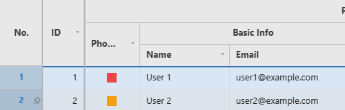
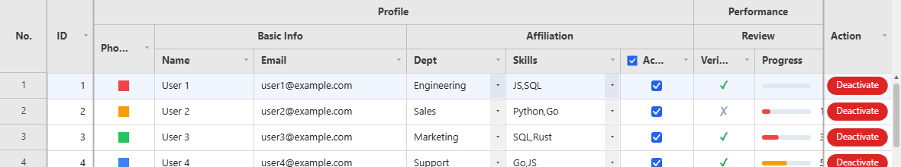

# Selection

What the user has selected, and how to read or set it from code.

**[See it running](demo.md#row-selection)**

Methods documented here: `clearRowSelection()`, `focusCell()`, `getHeaderCheckbox()`, `getSelectedRows()`, `getSelection()`, `setHeaderCheckbox()`, `setSelection()`, `startEditing()`, `stopEditing()`.

## Row Selection (`rowSelection`) / Header Checkbox

Setting `rowSelection: 'single' | 'multi'` lets you select rows by clicking the row-number cell
(or `Ctrl`/`Shift` for multi-select). `onRowSelect(rows)` is called whenever the selection changes,
and `getSelectedRows()` returns the currently selected row indices at any time. → [Live example](demo.md#row-selection)

How clicks behave:

- **`'single'`**: a click selects that row; clicking the selected row again clears it.
- **`'multi'`**: a click selects only that row, `Ctrl` (or `Cmd`) + click adds or removes a row,
  and `Shift` + click selects everything from the last clicked row to this one.
- On the keyboard, `Enter` or `Space` on a focused row number selects that row; see the
  [Interaction Reference](interaction.md).
- Clicking a cell clears the row selection unless `Ctrl`/`Shift` is held, and clicking a column
  header always does. With `showRowNumbers: false` there is no gutter to click, so clicking a cell
  selects its row instead.
- `onRowSelect` and `getSelectedRows()` give row indices in ascending order. The selection is cleared
  by a filter, a sort, `refresh()` and `reloadData()`, since those change which row an index means.
- With rows selected and no cell selected, `Ctrl+C` copies the selected rows, every column, as
  tab-separated text.



```js
const grid = new JHGrid({
  container: '#grid',
  fetchMeta, fetchData,
  rowSelection: 'multi',
  onRowSelect: (rows) => console.log('selected:', rows),
  columnDefs: [
    { field: 'name', label: 'Name', headerCheckbox: true },
    { field: 'age',  label: 'Age' },
  ],
});

grid.getSelectedRows();   // [2, 5, 9]
grid.clearRowSelection();
```

Setting `columnDefs[i].headerCheckbox: true` draws a checkbox in that column's header, and clicking it
calls `onHeaderCheckboxChange(field, checked)`. The box only records a checked state and reports it:
it does not select rows or change any cell by itself. What "checked" means is up to you, and the usual
answer is "tick or untick every row of a checkbox column", which `setCellValues()` does in one step:

```js
const rows = Array.from({ length: 200 }, (_, i) => ({ name: 'User ' + (i + 1), active: 'false' }));

const grid = new JHGrid({
  container: '#grid',
  data: rows,
  editableCols: ['active'],
  columnDefs: [
    { field: 'name' },
    { field: 'active', type: 'checkbox', width: 90, headerCheckbox: true },
  ],
  onHeaderCheckboxChange: (field, checked) => {
    // One undo step and one redraw for all 200 rows.
    grid.setCellValues(rows.map((_, row) => ({ row, field, value: String(checked) })));
  },
});
```



`setHeaderCheckbox(field, checked)` / `getHeaderCheckbox(field)` read and write the state from code;
`setHeaderCheckbox()` does not call `onHeaderCheckboxChange`. The state is part of
`getState()` (`headerCheckboxState`).

## Selection, Focus and Editing from Code (`getSelection` / `setSelection` / `focusCell` / `startEditing` / `stopEditing`)

Cell selection can be read and driven from code, and `onCellClick` reports clicks:

```js
const grid = new JHGrid({
  container: '#grid',
  fetchMeta, fetchData,
  onCellClick: (rowIndex, rowData, field) => console.log('clicked', rowIndex, field),
});

grid.getSelection();                                  // { type: 'single', row: 3, col: 1 } | { type: 'range', r1, c1, r2, c2 } | null
grid.setSelection({ row: 3, col: 'name' });           // one cell; a column is an index or a field name
grid.setSelection({ r1: 2, c1: 0, r2: 6, c2: 'age' }); // a range
grid.setSelection(null);                              // clear

grid.focusCell(3, 'name');                            // select it and give the grid keyboard focus
if (grid.startEditing(3, 'name')) { /* the editor is open */ }
grid.stopEditing();                                   // commit; grid.stopEditing({ cancel: true }) discards
```

- `onCellClick(rowIndex, rowData, field)` fires when the left button is pressed and released on the
  same cell, or when a cell is tapped, in addition to the built-in selection. A press that turns
  into a drag to another cell, a right-click and a click on a header or the row-number gutter do not
  count. `rowData` is `null` while the row is not loaded yet. On a pinned row `rowIndex` is the encoded
  pinned-row index (see [Pinned Rows](rows.md#pinned-rows-pinnedtoprows--pinnedbottomrows--pinrow)).
- `getSelection()` returns a copy in the same shape `onSelectionChange` reports, with columns as
  indexes. Whatever it returns can be passed straight to `setSelection()`.
- `setSelection(selection, { scroll })` scrolls the cell (a range's top-left cell) into view unless
  `scroll` is `false`. A row on another page switches to that page first. It fires
  `onSelectionChange`, commits an open editor, and leaves row selection
  ([`rowSelection`](#row-selection-rowselection--header-checkbox)) and keyboard focus alone.
- `focusCell(row, col)` is `setSelection()` on one cell plus keyboard focus, so the arrow keys,
  `Enter` and typing carry on from that cell.
- `startEditing(row, col)` selects the cell and opens its editor like a double-click. It returns
  `false` when nothing opened: a read-only cell, or a checkbox/button column. `stopEditing()` commits
  the open editor (or discards it with `{ cancel: true }`) and does nothing if none is open.
- A pinned row can be selected, focused and edited as a single cell (`row` is its encoded index). A
  range can only cover normal rows, and with pagination it cannot span two pages.
- A row that does not exist or a malformed selection throws a `TypeError`; an unknown field, an
  out-of-range column index or a range spanning two pages throws a `RangeError`.
